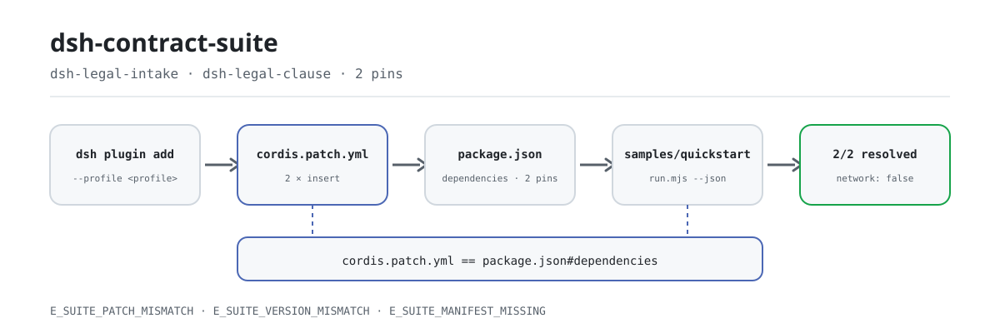
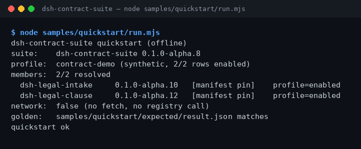

<div align="center">

<picture>
  <source media="(prefers-color-scheme: dark)" srcset="docs/assets/dsh-contract-suite-flow-dark.svg">
  
</picture>

# dsh-contract-suite

**Install both contract-legal packages in one command — then verify every member version resolves.**

An install-only suite for DeepSeek Harness: it pins `dsh-legal-intake` (contract intake) and `dsh-legal-clause` (clause/playbook review) to one exact version set and installs them together. The suite has no tool surface of its own — it reads no contracts, makes no network calls, and invokes no model.

[Install](#three-step-setup) · [Configuration](#configuration) · [FAQ](#faq) · [简体中文](README.md) · [English](README.en.md) · [Español](README.es.md) · [Português](README.pt.md) · [हिन्दी](README.hi.md)

[](LICENSE)
[](#compatibility)
[](https://www.npmjs.com/package/dsh-contract-suite)
[](https://github.com/PerryLink/dsh-contract-suite/actions/workflows/ci.yml)
[](#compatibility)

[](https://github.com/PerryLink/dsh-contract-suite/stargazers)
[](https://www.npmjs.com/package/dsh-contract-suite)
[](https://dshfind.com/plugins/PerryLink/dsh-contract-suite?ref=badge)
[](https://dsh.market/)
[](https://gitee.com/perrylink/dsh-plugins)

```sh
dsh plugin --profile <profile> add dsh-contract-suite
```

</div>

<sub>Community suite, not affiliated with DeepSeek. Canonical repository: <https://github.com/PerryLink/dsh-contract-suite> (Apache-2.0).</sub>

## What it is

`dsh-contract-suite` is an **install-only suite**: it does not review contracts; it installs both member packages into one DSH profile and pins their versions. `package.json#dependencies` fixes the exact versions of `dsh-legal-intake` (contract intake) and `dsh-legal-clause` (clause/playbook review), while `cordis.patch.yml` inserts the two member rows. Run the bundled offline sample after install and the terminal prints each member, its pinned version and how it resolved — 2/2 resolved means the set is complete. No network, no model call, no files written.

## Best for / not for

- **Best for:** installing contract intake and clause review into one DSH profile; keeping both members on one pinned version set; confirming no member row is missing right after install.
- **Not for:** installing only one package (install that member directly); expecting the suite itself to review contracts (it has no tool surface — the members do); OCR, external CLM, or e-sign integration.

## Input & output

**Input**

- The install itself reads no business documents.
- The bundled sample reads only `samples/quickstart/input/profile.json` (synthetic profile dump, < 1 KB), this package's `package.json` and `cordis.patch.yml`. It reads no other directory and no customer contract.
- Each member's own input (contract text, clause lists, playbook) is documented in that member's README; the suite does not change it.

**Output**

- The terminal prints the member list, pinned versions and where each version resolved from; 2/2 means both members resolve.
- `node samples/quickstart/run.mjs --json` prints the golden JSON stored at `samples/quickstart/expected/result.json`; `--check` compares it field by field.
- No files are written, no model is called, no network is used, nothing is uploaded, and source contracts are untouched.

## Three-step setup

1. **Install** (pick one channel):

   ```sh
   # npm channel (recommended, published releases)
   dsh plugin --profile <profile> add dsh-contract-suite
   # git channel (latest main)
   dsh plugin --profile <profile> add github:PerryLink/dsh-contract-suite
   # tarball channel: pnpm pack in this repo, then
   dsh plugin --profile <profile> add ./dsh-contract-suite-<version>.tgz
   # 1024 store channel
   npm i -g dsh1024 && dsh1024 plugin --profile <profile> add dsh-contract-suite
   ```

   No build step — pure ESM; `src/` and `samples/` are the shipped content.

2. **Assemble** (already done by default): the bundle applies `cordis.patch.yml`, inserting both member rows into the profile:

   ```yaml
   - insert:
       - id: dsh-legal-intake
         name: dsh-legal-intake
       - id: dsh-legal-clause
         name: dsh-legal-clause
   ```

   The suite has no configuration keys; each member's configuration lives in its own README.

3. **Verify it took effect**:

   ```sh
   dsh --profile <profile> --dump-config | grep dsh-contract-suite
   node samples/quickstart/run.mjs
   ```

   Real output (run on 2026-11-05, member-resolution section):

   ```text
   dsh-contract-suite quickstart (offline)
   suite:    dsh-contract-suite 0.1.0-alpha.10
   profile:  contract-demo (synthetic, 2/2 rows enabled)
   members:  2/2 resolved
     dsh-legal-intake     0.1.0-alpha.10   [manifest pin]    profile=enabled
     dsh-legal-clause     0.1.0-alpha.12   [manifest pin]    profile=enabled
   network:  false (no fetch, no registry call)
   ```

**Uninstall**: `dsh plugin --profile <profile> remove dsh-contract-suite` (or remove the row from the profile patch). Removing the suite removes only the suite row; the member packages stay installed.

## Core capabilities

- **One command installs the set** — a single `dsh plugin add` installs both members, so you do not track two package names and versions separately.
- **Versions locked together** — member versions are pinned in `package.json#dependencies`; an installed member at any other version raises `E_SUITE_VERSION_MISMATCH` instead of silently mixing versions. Upgrade the suite, not an individual member.
- **Member-row reconciliation** — `cordis.patch.yml` and `dependencies` are checked in both directions: a missing row, an extra row, a duplicate id, or an `id`/`name` mismatch raises `E_SUITE_PATCH_MISMATCH`; a missing or malformed manifest raises `E_SUITE_MANIFEST_MISSING`.
- **Offline self-check** — `samples/quickstart/run.mjs` reads three files and prints members, pins and resolution sources; `--json` gives machine-readable output, `--check` compares it with the golden file. Zero network, zero writes.
- **No tool surface** — it registers no tools, commands, slots, HTTP routes or service keys, and only inserts two member rows; members stay independent and can be installed or removed on their own.
- **Reproducible evidence** — `ACCEPTANCE.csv` records the public acceptance rows (`counted` marks whether a row counts), `screenshots.json` records the screenshot command, time and SHA-256, and `node scripts/acceptance.mjs` rebuilds the rows.

## Members & versions

The suite only installs these members; it has no tool surface of its own. Versions are pinned in `dependencies`.

| Member | Pinned version |
|---|---:|
| `dsh-legal-intake` | `0.1.0-alpha.10` |
| `dsh-legal-clause` | `0.1.0-alpha.12` |

Current suite version: `0.1.0-alpha.10` (matches `package.json`).

## Example

Paste this into DSH:

> Install both contract-legal packages (contract intake and clause review), confirm both member packages resolve, and list each version.

Then run the bundled sample from the package directory (offline, no dependency install needed):

```sh
node samples/quickstart/run.mjs
```

The real output is in step 3 of "Three-step setup". The screenshot is the real terminal output of the same command captured on 2026-11-02 (suite version was `0.1.0-alpha.8` then; member versions are the same as now):



Screenshot metadata (command, time, output SHA-256) is in `screenshots.json`.

## Configuration

The suite is an install-only bundle: **no Config schema and no runtime keys**. Only the assembly surface and the install target are adjustable:

| Adjustable | Where | Current value | Notes |
|---|---|---|---|
| Member set | `cordis.patch.yml` | `dsh-legal-intake`, `dsh-legal-clause` | One `id` + `name` row per member; must match `dependencies` exactly |
| Member versions | `package.json#dependencies` | `0.1.0-alpha.10`, `0.1.0-alpha.12` | Exact pins; upgrading one member raises `E_SUITE_VERSION_MISMATCH` |
| Install target | `dsh plugin --profile <profile>` | your choice | The suite installs into the named profile only |
| Demo metadata | `package.json#dsh.demo` | `sample` / `prompt` / `expect` / `screenshot` | Declares the offline sample, prompt and evidence paths |

Each member's configuration (contract text, clause lists, playbook) lives in the member's README; the suite neither reads nor rewrites it, and does not overwrite member config rows.

<details>
<summary>Full assembly file (cordis.patch.yml)</summary>

```yaml
- insert:
    - id: dsh-legal-intake
      name: dsh-legal-intake
    - id: dsh-legal-clause
      name: dsh-legal-clause
```

</details>

<details>
<summary>Install channels compared</summary>

| Channel | Command | Use when |
|---|---|---|
| npm (recommended) | `dsh plugin --profile <profile> add dsh-contract-suite` | Normal install from a published release |
| git | `dsh plugin --profile <profile> add github:PerryLink/dsh-contract-suite` | Tracking latest main |
| tarball | `pnpm pack`, then `dsh plugin --profile <profile> add ./dsh-contract-suite-<version>.tgz` | Offline or pinned artifact |
| 1024 store | `npm i -g dsh1024`, then `dsh1024 plugin --profile <profile> add dsh-contract-suite` | Installing through the 1024 channel |

</details>

## FAQ

<details>
<summary>The install fails, or a member is missing afterward. What now?</summary>

Run `node samples/quickstart/run.mjs` first. If the two member lists disagree it raises `E_SUITE_PATCH_MISMATCH`; align `cordis.patch.yml` with `dependencies` as described in [TROUBLESHOOTING.md](TROUBLESHOOTING.md), then reinstall. A missing manifest or an incomplete tarball raises `E_SUITE_MANIFEST_MISSING`; rerun from the package root or reinstall.

</details>

<details>
<summary>The version does not match the suite declaration. Why?</summary>

The suite pins exact member versions and promises one fixed set. Upgrading one member alone, or leaving an old version in `node_modules`, raises `E_SUITE_VERSION_MISMATCH`. Remove `node_modules` in that profile and reinstall the suite; if you truly need a newer member, wait for a suite release that pins it — do not upgrade the member alone.

</details>

<details>
<summary>Can the suite review my contracts?</summary>

No. The suite only installs members and has no tool surface of its own; contract intake and clause review run through the member packages' tools. The bundled sample uses a synthetic profile, reads no real contract, and produces no review result.

</details>

<details>
<summary>Does uninstalling the suite remove the members?</summary>

No. Removing the suite removes only its row; member packages stay installed until you remove them individually. Members are independent Cordis rows and can also be installed without the suite.

</details>

<details>
<summary>Where is data stored? Does it go online or upload anything?</summary>

The install reads no business documents; the bundled sample reads only three files: `samples/quickstart/input/profile.json`, `cordis.patch.yml` and `package.json`. It writes no files, uses no network, uploads nothing and calls no model. The only network-touching piece is the developer-side `scripts/check.mjs` (it queries the registry to confirm member versions exist), which does not run at install or runtime.

</details>

## Permissions & data

- Read: `samples/quickstart/input/profile.json`, `cordis.patch.yml`, `package.json`; no other directory
- Write: none (R0 — terminal output only; no `$DSH_HOME` writes, source files untouched)
- Network: no
- External systems: none
- Public/synthetic fixtures only; no customer data and no customer evidence.
- Alpha/partial; not counted, no GA or production-readiness claim.

## Security boundaries

- **Installs only; processes no content.** The suite has no tool surface, no commands, and registers no slot or HTTP route; contract content stays in the member packages and your local environment.
- **Public/synthetic samples.** The repository contains only public or synthetic fixtures; no customer data, customer contracts or customer evidence, and no production-readiness claim.
- **Fails closed.** A missing manifest, a patch/dependency mismatch, or member version drift fails loudly with an explicit `E_` code at load/self-check time — never a silent downgrade or a mixed install.
- **Never rewrites member config.** The bundle patch only `insert`s its two rows; it does not overwrite the `config` of built-in or member rows.
- **Least privilege.** The install writes no `$DSH_HOME` and touches no source files; each member tool's permission and data boundaries are documented in its own repository and `ACCEPTANCE`.

## Known limitations

- **Install-only.** The suite has no tool surface of its own; it cannot review contracts and provides no OCR, external CLM or e-sign integration. Those capabilities (where they exist) belong to the members.
- **Alpha / partial / not counted.** No GA or production-readiness claim; public acceptance rows marked `counted=false` do not count as formal acceptance.
- **Versions are decided by suite releases.** With members pinned, upgrading a member alone fails; changing a member version requires a new suite release.
- **The sample golden lags one release.** `samples/quickstart/expected/result.json` still records `0.1.0-alpha.8`, while the current package is `0.1.0-alpha.10`; `run.mjs --check` and the tests that depend on it therefore report a golden mismatch. Treat `run.mjs --json` as the source of truth and regenerate the golden file to restore the check. This does not affect installation or member resolution.
- **No configuration keys.** Adjustable member settings live in each member's README; the suite adds no switches.

## Interoperability with other DSH plugins

- **No shared service, port or storage domain.** The suite and its members occupy no shared service, port or storage domain; members are independent Cordis rows.
- **No tool/command/slot/route registration.** The suite registers no tools, commands, client slots or `webServer` prefixes, so there are no name clashes or slot contention.
- **Insert only, never overwrite.** The bundle patch only `insert`s member rows; it does not overwrite the `config` of built-in or member rows.
- **Individually installable.** Members can be installed and removed without the suite; uninstalling the suite does not take them away.
- **Channel-independent.** npm, git, tarball and the 1024 store all produce the same member set and versions.

## Compatibility

| Surface | Status |
|---|---|
| Harness | `dsh >=0.2.1-rc.3 <0.3.0` |
| Node | `>=24.9.0 <25` |
| Platforms | All DSH-capable platforms; local files only |
| Data | No network, no model call, no upload |

## Ecosystem & quality

- [Domain index](https://perrylink.github.io/dsh-plugins/) (package catalog and install entry points)
- [Checker family](https://perrylink.github.io/zh/checkers/) (checker plugin overview)
- [Mainline family](https://github.com/PerryLink/dsh-kit) (install specs and family index)
- [Gitee aggregate mirror](https://gitee.com/perrylink/dsh-plugins) (GitHub is canonical)
- [dshfind plugin page](https://dshfind.com/plugins/PerryLink/dsh-contract-suite) (installs and ranking)
- [DSH Market](https://dsh.market/) (listed)
- **1024 store channel**: `npm i -g dsh1024`, then `dsh1024 plugin --profile <profile> add dsh-contract-suite` (counts toward the [deepseek1024.com](https://deepseek1024.com) install ranking)
- **Evidence files**: [`ACCEPTANCE.csv`](ACCEPTANCE.csv) · [`screenshots.json`](screenshots.json) · [`samples/quickstart/expected/result.json`](samples/quickstart/expected/result.json)

## Development

```sh
pnpm install --frozen-lockfile
pnpm quickstart        # node samples/quickstart/run.mjs
pnpm test              # node --test test/suite.test.mjs
pnpm gate              # node scripts/gate.mjs (offline release gate)
pnpm check             # node scripts/check.mjs (registry lookup, CI only)
```

No build step: the shipped content is `src/` + `samples/` + `cordis.patch.yml`.

| Path | Purpose |
|---|---|
| `src/members.mjs` | The only runtime code: reads `package.json` + `cordis.patch.yml`, validates members, resolves versions |
| `samples/quickstart/` | Offline sample: `input/profile.json`, `expected/result.json`, `run.mjs` |
| `test/suite.test.mjs` | `node --test`: manifest, sample, golden, error branches |
| `scripts/gate.mjs` | Release gate: manifest, sample, doc blocks, evidence, golden, tests |
| `scripts/check.mjs` | Registry install smoke (CI only; the one networked script) |
| `scripts/acceptance.mjs` | Rebuilds `ACCEPTANCE.csv` from real local checks |
| `scripts/gen-readme-assets.py` | Generates the README figures (Python + Pillow) |
| `docs/assets/` | Flow diagrams and the quickstart screenshot |
| `cordis.patch.yml` | Member assembly surface (two `insert` rows) |

Figures are generated by [`scripts/gen-readme-assets.py`](scripts/gen-readme-assets.py): `python scripts/gen-readme-assets.py` writes `docs/assets/dsh-contract-suite-flow-{light,dark}.svg` (vector, shared by all five languages) and leaves the legacy single-skin `dsh-contract-suite-flow.svg` untouched. The script is safe to re-run.

Five-language READMEs: `README.md` is the Chinese source; `README.en.md`, `README.es.md`, `README.pt.md` and `README.hi.md` follow it.

Topics: `dsh`, `deepseek-harness`, `dsh-plugin`, `dsh-bundle`, `perrylink`, `suite`, `legal`

## Family & thanks

This project is a member of the [PerryLink](https://github.com/PerryLink) DeepSeek Harness plugin family (all Apache-2.0). If this suite helps you, **give it a star** — it unlocks nothing, but it makes the next person more likely to find it.

- [dsh-legal-intake](https://github.com/PerryLink/dsh-legal-intake) — the contract intake member.
- [dsh-legal-clause](https://github.com/PerryLink/dsh-legal-clause) — the clause/playbook review member.
- [@PerryLink](https://github.com/PerryLink) — creator and maintainer: suite contract, version pinning, offline quickstart, acceptance rows and five-language docs.

<details>
<summary>DSH domain plugin family (15 packages + 2 suites)</summary>

| Package | npm |
|---|---|
| **[dsh-einvoice](https://github.com/PerryLink/dsh-einvoice)** | [npm](https://www.npmjs.com/package/dsh-einvoice) |
| **[dsh-docx-redline](https://github.com/PerryLink/dsh-docx-redline)** | [npm](https://www.npmjs.com/package/dsh-docx-redline) |
| **[dsh-policy-ledger](https://github.com/PerryLink/dsh-policy-ledger)** | [npm](https://www.npmjs.com/package/dsh-policy-ledger) |
| **[dsh-ghg](https://github.com/PerryLink/dsh-ghg)** | [npm](https://www.npmjs.com/package/dsh-ghg) |
| **[dsh-bankrec](https://github.com/PerryLink/dsh-bankrec)** | [npm](https://www.npmjs.com/package/dsh-bankrec) |
| **[dsh-ap-three-way](https://github.com/PerryLink/dsh-ap-three-way)** | [npm](https://www.npmjs.com/package/dsh-ap-three-way) |
| **[dsh-ifc-qto](https://github.com/PerryLink/dsh-ifc-qto)** | [npm](https://www.npmjs.com/package/dsh-ifc-qto) |
| **[dsh-qms-capa](https://github.com/PerryLink/dsh-qms-capa)** | [npm](https://www.npmjs.com/package/dsh-qms-capa) |
| **[dsh-legal-intake](https://github.com/PerryLink/dsh-legal-intake)** | [npm](https://www.npmjs.com/package/dsh-legal-intake) |
| **[dsh-legal-clause](https://github.com/PerryLink/dsh-legal-clause)** | [npm](https://www.npmjs.com/package/dsh-legal-clause) |
| **[dsh-freight-audit](https://github.com/PerryLink/dsh-freight-audit)** | [npm](https://www.npmjs.com/package/dsh-freight-audit) |
| **[dsh-hs-candidate](https://github.com/PerryLink/dsh-hs-candidate)** | [npm](https://www.npmjs.com/package/dsh-hs-candidate) |
| **[dsh-travel-recon](https://github.com/PerryLink/dsh-travel-recon)** | [npm](https://www.npmjs.com/package/dsh-travel-recon) |
| **[dsh-pim-lint](https://github.com/PerryLink/dsh-pim-lint)** | [npm](https://www.npmjs.com/package/dsh-pim-lint) |
| **[dsh-eval-pack](https://github.com/PerryLink/dsh-eval-pack)** | [npm](https://www.npmjs.com/package/dsh-eval-pack) |
| **[dsh-finops-suite](https://github.com/PerryLink/dsh-finops-suite)** | [npm](https://www.npmjs.com/package/dsh-finops-suite) |
| **[dsh-contract-suite](https://github.com/PerryLink/dsh-contract-suite)** | [npm](https://www.npmjs.com/package/dsh-contract-suite) |

</details>

<details>
<summary>Mainline family — 87 current install specs</summary>

| Package | npm |
|---|---|
| **[dsh-aqua-input-check](https://github.com/PerryLink/dsh-aqua-input-check)** | [npm](https://www.npmjs.com/package/dsh-aqua-input-check) |
| **[dsh-archive-check](https://github.com/PerryLink/dsh-archive-check)** | [npm](https://www.npmjs.com/package/dsh-archive-check) |
| **[dsh-bid-ca-precheck](https://github.com/PerryLink/dsh-bid-ca-precheck)** | [npm](https://www.npmjs.com/package/dsh-bid-ca-precheck) |
| **[dsh-bid-qual-check](https://github.com/PerryLink/dsh-bid-qual-check)** | [npm](https://www.npmjs.com/package/dsh-bid-qual-check) |
| **[dsh-contract-stance](https://github.com/PerryLink/dsh-contract-stance)** | [npm](https://www.npmjs.com/package/dsh-contract-stance) |
| **[dsh-customs-doc-check](https://github.com/PerryLink/dsh-customs-doc-check)** | [npm](https://www.npmjs.com/package/dsh-customs-doc-check) |
| **[dsh-demurrage-ledger](https://github.com/PerryLink/dsh-demurrage-ledger)** | [npm](https://www.npmjs.com/package/dsh-demurrage-ledger) |
| **[dsh-drill-script-check](https://github.com/PerryLink/dsh-drill-script-check)** | [npm](https://www.npmjs.com/package/dsh-drill-script-check) |
| **[dsh-eia-guide-check](https://github.com/PerryLink/dsh-eia-guide-check)** | [npm](https://www.npmjs.com/package/dsh-eia-guide-check) |
| **[dsh-emergency-plan](https://github.com/PerryLink/dsh-emergency-plan)** | [npm](https://www.npmjs.com/package/dsh-emergency-plan) |
| **[dsh-essay-rubric-check](https://github.com/PerryLink/dsh-essay-rubric-check)** | [npm](https://www.npmjs.com/package/dsh-essay-rubric-check) |
| **[dsh-evidence-check](https://github.com/PerryLink/dsh-evidence-check)** | [npm](https://www.npmjs.com/package/dsh-evidence-check) |
| **[dsh-export-ctl-check](https://github.com/PerryLink/dsh-export-ctl-check)** | [npm](https://www.npmjs.com/package/dsh-export-ctl-check) |
| **[dsh-fmea-table-check](https://github.com/PerryLink/dsh-fmea-table-check)** | [npm](https://www.npmjs.com/package/dsh-fmea-table-check) |
| **[dsh-forecast-penalty](https://github.com/PerryLink/dsh-forecast-penalty)** | [npm](https://www.npmjs.com/package/dsh-forecast-penalty) |
| **[dsh-gongwen-flow-check](https://github.com/PerryLink/dsh-gongwen-flow-check)** | [npm](https://www.npmjs.com/package/dsh-gongwen-flow-check) |
| **[dsh-gongwen-word-check](https://github.com/PerryLink/dsh-gongwen-word-check)** | [npm](https://www.npmjs.com/package/dsh-gongwen-word-check) |
| **[dsh-guard-plan-qc](https://github.com/PerryLink/dsh-guard-plan-qc)** | [npm](https://www.npmjs.com/package/dsh-guard-plan-qc) |
| **[dsh-hazchem-check](https://github.com/PerryLink/dsh-hazchem-check)** | [npm](https://www.npmjs.com/package/dsh-hazchem-check) |
| **[dsh-hazplan-check](https://github.com/PerryLink/dsh-hazplan-check)** | [npm](https://www.npmjs.com/package/dsh-hazplan-check) |
| **[dsh-hidden-risk-map](https://github.com/PerryLink/dsh-hidden-risk-map)** | [npm](https://www.npmjs.com/package/dsh-hidden-risk-map) |
| **[dsh-hs-classify](https://github.com/PerryLink/dsh-hs-classify)** | [npm](https://www.npmjs.com/package/dsh-hs-classify) |
| **[dsh-icd-rule-check](https://github.com/PerryLink/dsh-icd-rule-check)** | [npm](https://www.npmjs.com/package/dsh-icd-rule-check) |
| **[dsh-lawcite-adapter](https://github.com/PerryLink/dsh-lawcite-adapter)** | [npm](https://www.npmjs.com/package/dsh-lawcite-adapter) |
| **[dsh-lc-doc-check](https://github.com/PerryLink/dsh-lc-doc-check)** | [npm](https://www.npmjs.com/package/dsh-lc-doc-check) |
| **[dsh-learning-gap-check](https://github.com/PerryLink/dsh-learning-gap-check)** | [npm](https://www.npmjs.com/package/dsh-learning-gap-check) |
| **[dsh-medrec-qc](https://github.com/PerryLink/dsh-medrec-qc)** | [npm](https://www.npmjs.com/package/dsh-medrec-qc) |
| **[dsh-nsfc-form-check](https://github.com/PerryLink/dsh-nsfc-form-check)** | [npm](https://www.npmjs.com/package/dsh-nsfc-form-check) |
| **[dsh-nurse-record-check](https://github.com/PerryLink/dsh-nurse-record-check)** | [npm](https://www.npmjs.com/package/dsh-nurse-record-check) |
| **[dsh-origin-rvc-check](https://github.com/PerryLink/dsh-origin-rvc-check)** | [npm](https://www.npmjs.com/package/dsh-origin-rvc-check) |
| **[dsh-ota-review-check](https://github.com/PerryLink/dsh-ota-review-check)** | [npm](https://www.npmjs.com/package/dsh-ota-review-check) |
| **[dsh-paper-doc-adapter](https://github.com/PerryLink/dsh-paper-doc-adapter)** | [npm](https://www.npmjs.com/package/dsh-paper-doc-adapter) |
| **[dsh-permit-report-check](https://github.com/PerryLink/dsh-permit-report-check)** | [npm](https://www.npmjs.com/package/dsh-permit-report-check) |
| **[dsh-pipeline-check](https://github.com/PerryLink/dsh-pipeline-check)** | [npm](https://www.npmjs.com/package/dsh-pipeline-check) |
| **[dsh-pleading-draft](https://github.com/PerryLink/dsh-pleading-draft)** | [npm](https://www.npmjs.com/package/dsh-pleading-draft) |
| **[dsh-policy-brief-draft](https://github.com/PerryLink/dsh-policy-brief-draft)** | [npm](https://www.npmjs.com/package/dsh-policy-brief-draft) |
| **[dsh-power-loss-split](https://github.com/PerryLink/dsh-power-loss-split)** | [npm](https://www.npmjs.com/package/dsh-power-loss-split) |
| **[dsh-power-ticket-check](https://github.com/PerryLink/dsh-power-ticket-check)** | [npm](https://www.npmjs.com/package/dsh-power-ticket-check) |
| **[dsh-ppap-check](https://github.com/PerryLink/dsh-ppap-check)** | [npm](https://www.npmjs.com/package/dsh-ppap-check) |
| **[dsh-protest-deadline](https://github.com/PerryLink/dsh-protest-deadline)** | [npm](https://www.npmjs.com/package/dsh-protest-deadline) |
| **[dsh-railway-window](https://github.com/PerryLink/dsh-railway-window)** | [npm](https://www.npmjs.com/package/dsh-railway-window) |
| **[dsh-repair-order-qc](https://github.com/PerryLink/dsh-repair-order-qc)** | [npm](https://www.npmjs.com/package/dsh-repair-order-qc) |
| **[dsh-review-reply-check](https://github.com/PerryLink/dsh-review-reply-check)** | [npm](https://www.npmjs.com/package/dsh-review-reply-check) |
| **[dsh-rulefile-check](https://github.com/PerryLink/dsh-rulefile-check)** | [npm](https://www.npmjs.com/package/dsh-rulefile-check) |
| **[dsh-safety-brief-check](https://github.com/PerryLink/dsh-safety-brief-check)** | [npm](https://www.npmjs.com/package/dsh-safety-brief-check) |
| **[dsh-site-log-check](https://github.com/PerryLink/dsh-site-log-check)** | [npm](https://www.npmjs.com/package/dsh-site-log-check) |
| **[dsh-soe-decision-check](https://github.com/PerryLink/dsh-soe-decision-check)** | [npm](https://www.npmjs.com/package/dsh-soe-decision-check) |
| **[dsh-soilwater-check](https://github.com/PerryLink/dsh-soilwater-check)** | [npm](https://www.npmjs.com/package/dsh-soilwater-check) |
| **[dsh-sop-sync-check](https://github.com/PerryLink/dsh-sop-sync-check)** | [npm](https://www.npmjs.com/package/dsh-sop-sync-check) |
| **[dsh-spc-gbt-adapter](https://github.com/PerryLink/dsh-spc-gbt-adapter)** | [npm](https://www.npmjs.com/package/dsh-spc-gbt-adapter) |
| **[dsh-tender-extract](https://github.com/PerryLink/dsh-tender-extract)** | [npm](https://www.npmjs.com/package/dsh-tender-extract) |
| **[dsh-tender-matrix](https://github.com/PerryLink/dsh-tender-matrix)** | [npm](https://www.npmjs.com/package/dsh-tender-matrix) |
| **[dsh-warranty-calc](https://github.com/PerryLink/dsh-warranty-calc)** | [npm](https://www.npmjs.com/package/dsh-warranty-calc) |
| **[dsh-auto-review](https://github.com/PerryLink/dsh-auto-review)** | [npm](https://www.npmjs.com/package/dsh-auto-review) |
| **[dsh-autotier](https://github.com/PerryLink/dsh-autotier)** | [npm](https://www.npmjs.com/package/dsh-autotier) |
| **[dsh-budget](https://github.com/PerryLink/dsh-budget)** | [npm](https://www.npmjs.com/package/dsh-budget) |
| **[dsh-cert-mcp](https://github.com/PerryLink/dsh-cert-mcp)** | [npm](https://www.npmjs.com/package/dsh-cert-mcp) |
| **[dsh-checkpoint-rewind](https://github.com/PerryLink/dsh-checkpoint-rewind)** | [npm](https://www.npmjs.com/package/dsh-checkpoint-rewind) |
| **[dsh-claude-move](https://github.com/PerryLink/dsh-claude-move)** | [npm](https://www.npmjs.com/package/dsh-claude-move) |
| **[dsh-click](https://github.com/PerryLink/dsh-click)** | [npm](https://www.npmjs.com/package/dsh-click) |
| **[dsh-composer-history](https://github.com/PerryLink/dsh-composer-history)** | [npm](https://www.npmjs.com/package/dsh-composer-history) |
| **[dsh-data-quality](https://github.com/PerryLink/dsh-data-quality)** | [npm](https://www.npmjs.com/package/dsh-data-quality) |
| **[dsh-defend](https://github.com/PerryLink/dsh-defend)** | [npm](https://www.npmjs.com/package/dsh-defend) |
| **[dsh-doublecheck](https://github.com/PerryLink/dsh-doublecheck)** | [npm](https://www.npmjs.com/package/dsh-doublecheck) |
| **[dsh-draw](https://github.com/PerryLink/dsh-draw)** | [npm](https://www.npmjs.com/package/dsh-draw) |
| **[dsh-fast](https://github.com/PerryLink/dsh-fast)** | [npm](https://www.npmjs.com/package/dsh-fast) |
| **[dsh-fund-research](https://github.com/PerryLink/dsh-fund-research)** | [npm](https://www.npmjs.com/package/dsh-fund-research) |
| **[dsh-industry-research](https://github.com/PerryLink/dsh-industry-research)** | [npm](https://www.npmjs.com/package/dsh-industry-research) |
| **[dsh-laya](https://github.com/PerryLink/dsh-laya)** | [npm](https://www.npmjs.com/package/dsh-laya) |
| **[dsh-library](https://github.com/PerryLink/dsh-library)** | [npm](https://www.npmjs.com/package/dsh-library) |
| **[dsh-local-ai](https://github.com/PerryLink/dsh-local-ai)** | [npm](https://www.npmjs.com/package/dsh-local-ai) |
| **[dsh-lsp-actions](https://github.com/PerryLink/dsh-lsp-actions)** | [npm](https://www.npmjs.com/package/dsh-lsp-actions) |
| **[dsh-mask](https://github.com/PerryLink/dsh-mask)** | [npm](https://www.npmjs.com/package/dsh-mask) |
| **[dsh-mcp-panel](https://github.com/PerryLink/dsh-mcp-panel)** | [npm](https://www.npmjs.com/package/dsh-mcp-panel) |
| **[dsh-memento](https://github.com/PerryLink/dsh-memento)** | [npm](https://www.npmjs.com/package/dsh-memento) |
| **[dsh-observe](https://github.com/PerryLink/dsh-observe)** | [npm](https://www.npmjs.com/package/dsh-observe) |
| **[dsh-output-styles](https://github.com/PerryLink/dsh-output-styles)** | [npm](https://www.npmjs.com/package/dsh-output-styles) |
| **[dsh-permission-rules](https://github.com/PerryLink/dsh-permission-rules)** | [npm](https://www.npmjs.com/package/dsh-permission-rules) |
| **[dsh-plugin-guide](https://github.com/PerryLink/dsh-plugin-guide)** | [npm](https://www.npmjs.com/package/dsh-plugin-guide) |
| **[dsh-plugin-upgrade](https://github.com/PerryLink/dsh-plugin-upgrade)** | [npm](https://www.npmjs.com/package/dsh-plugin-upgrade) |
| **[dsh-reach](https://github.com/PerryLink/dsh-reach)** | [npm](https://www.npmjs.com/package/dsh-reach) |
| **[dsh-research-report](https://github.com/PerryLink/dsh-research-report)** | [npm](https://www.npmjs.com/package/dsh-research-report) |
| **[dsh-score](https://github.com/PerryLink/dsh-score)** | [npm](https://www.npmjs.com/package/dsh-score) |
| **[dsh-session-sync](https://github.com/PerryLink/dsh-session-sync)** | [npm](https://www.npmjs.com/package/dsh-session-sync) |
| **[dsh-talk](https://github.com/PerryLink/dsh-talk)** | [npm](https://www.npmjs.com/package/dsh-talk) |
| **[dsh-test-drive](https://github.com/PerryLink/dsh-test-drive)** | [npm](https://www.npmjs.com/package/dsh-test-drive) |
| **[dsh-translate](https://github.com/PerryLink/dsh-translate)** | [npm](https://www.npmjs.com/package/dsh-translate) |

</details>

## License

[LICENSE](LICENSE) (Apache License 2.0) © 2026 dsh-contract-suite contributors

<p align="center"><sub>Apache-2.0 · Community suite, not affiliated with DeepSeek.</sub></p>
