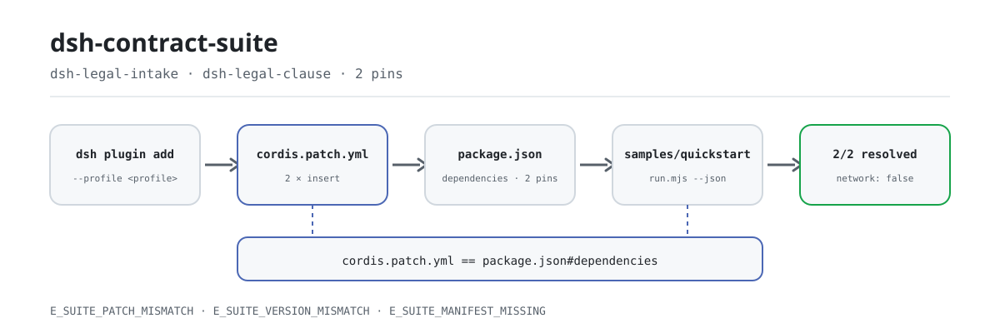
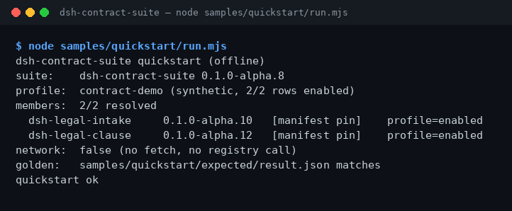

<div align="center">

<picture>
  <source media="(prefers-color-scheme: dark)" srcset="docs/assets/dsh-contract-suite-flow-dark.svg">
  
</picture>

# dsh-contract-suite

**Instala los dos paquetes de contratos y legal con un solo comando y verifica que cada versión de miembro se resuelva.**

Suite solo de instalación para DeepSeek Harness: fija `dsh-legal-intake` (entrada de contratos) y `dsh-legal-clause` (revisión de cláusulas/playbook) en un único conjunto de versiones exactas y los instala juntos. La suite no tiene superficie de herramientas propia: no lee contratos, no hace llamadas de red ni invoca modelos.

[Instalación](#instalación-en-tres-pasos) · [Configuración](#configuración) · [FAQ](#faq) · [简体中文](README.md) · [English](README.en.md) · [Español](README.es.md) · [Português](README.pt.md) · [हिन्दी](README.hi.md)

[](LICENSE)
[](#compatibilidad)
[](https://www.npmjs.com/package/dsh-contract-suite)
[](https://github.com/PerryLink/dsh-contract-suite/actions/workflows/ci.yml)
[](#compatibilidad)

[](https://github.com/PerryLink/dsh-contract-suite/stargazers)
[](https://www.npmjs.com/package/dsh-contract-suite)
[](https://dshfind.com/plugins/PerryLink/dsh-contract-suite?ref=badge)
[](https://dsh.market/)
[](https://gitee.com/perrylink/dsh-plugins)

```sh
dsh plugin --profile <profile> add dsh-contract-suite
```

</div>

<sub>Suite de la comunidad, no afiliada a DeepSeek. Repositorio canónico: <https://github.com/PerryLink/dsh-contract-suite> (Apache-2.0).</sub>

## Qué es

`dsh-contract-suite` es una **suite solo de instalación**: no revisa contratos; instala los dos paquetes miembros en un mismo perfil de DSH y fija sus versiones. `package.json#dependencies` fija las versiones exactas de `dsh-legal-intake` (entrada de contratos) y `dsh-legal-clause` (revisión de cláusulas/playbook), mientras que `cordis.patch.yml` inserta las dos filas de miembros. Ejecuta el ejemplo offline incluido tras instalar y la terminal muestra cada miembro, su versión fijada y cómo se resolvió: 2/2 resolved significa que el conjunto está completo. Sin red, sin llamadas a modelos y sin escribir archivos.

## Para qué sirve / para qué no

- **Sirve para:** instalar entrada de contratos y revisión de cláusulas en un mismo perfil de DSH; mantener ambos miembros en un único conjunto de versiones fijadas; confirmar justo después de instalar que no falta ninguna fila de miembro.
- **No sirve para:** instalar un solo paquete (instala ese miembro directamente); esperar que la suite revise contratos (no tiene superficie de herramientas: lo hacen los miembros); integración con OCR, CLM externo o e-sign.

## Entrada y salida

**Entrada**

- La instalación en sí no lee documentos de negocio.
- El ejemplo incluido solo lee `samples/quickstart/input/profile.json` (volcado de perfil sintético, < 1 KB), el `package.json` de este paquete y `cordis.patch.yml`. No lee otro directorio ni contratos de clientes.
- La entrada propia de cada miembro (texto del contrato, listas de cláusulas, playbook) se documenta en el README de ese miembro; la suite no la cambia.

**Salida**

- La terminal muestra la lista de miembros, las versiones fijadas y de dónde se resolvió cada versión; 2/2 significa que ambos miembros se resuelven.
- `node samples/quickstart/run.mjs --json` imprime el JSON dorado guardado en `samples/quickstart/expected/result.json`; `--check` lo compara campo por campo.
- No escribe archivos, no llama a modelos, no usa red, no sube nada y no toca los contratos originales.

## Instalación en tres pasos

1. **Instalar** (elige un canal):

   ```sh
   # canal npm (recomendado, versiones publicadas)
   dsh plugin --profile <profile> add dsh-contract-suite
   # canal git (último main)
   dsh plugin --profile <profile> add github:PerryLink/dsh-contract-suite
   # canal tarball: pnpm pack en este repositorio y luego
   dsh plugin --profile <profile> add ./dsh-contract-suite-<version>.tgz
   # canal tienda 1024
   npm i -g dsh1024 && dsh1024 plugin --profile <profile> add dsh-contract-suite
   ```

   Sin paso de compilación: ESM puro; `src/` y `samples/` son el contenido publicado.

2. **Montar** (ya ocurre por defecto): el bundle aplica `cordis.patch.yml` e inserta las dos filas de miembros en el perfil:

   ```yaml
   - insert:
       - id: dsh-legal-intake
         name: dsh-legal-intake
       - id: dsh-legal-clause
         name: dsh-legal-clause
   ```

   La suite no tiene claves de configuración; la configuración de cada miembro está en su propio README.

3. **Verificar que surtió efecto**:

   ```sh
   dsh --profile <profile> --dump-config | grep dsh-contract-suite
   node samples/quickstart/run.mjs
   ```

   Salida real (ejecutada el 2026-11-05, tramo de resolución de miembros):

   ```text
   dsh-contract-suite quickstart (offline)
   suite:    dsh-contract-suite 0.1.0-alpha.10
   profile:  contract-demo (synthetic, 2/2 rows enabled)
   members:  2/2 resolved
     dsh-legal-intake     0.1.0-alpha.10   [manifest pin]    profile=enabled
     dsh-legal-clause     0.1.0-alpha.12   [manifest pin]    profile=enabled
   network:  false (no fetch, no registry call)
   ```

**Desinstalar**: `dsh plugin --profile <profile> remove dsh-contract-suite` (o borra la fila del patch del perfil). Desinstalar la suite elimina solo su fila; los paquetes miembros siguen instalados.

## Capacidades clave

- **Un comando instala el conjunto** — un solo `dsh plugin add` instala ambos miembros, sin tener que recordar dos nombres y dos versiones.
- **Versiones bloqueadas en conjunto** — las versiones de los miembros se fijan en `package.json#dependencies`; un miembro instalado con otra versión provoca `E_SUITE_VERSION_MISMATCH` en lugar de mezclar versiones en silencio. Actualiza la suite, no un miembro suelto.
- **Conciliación de filas** — `cordis.patch.yml` y `dependencies` se comprueban en ambos sentidos: falta una fila, sobra una, hay un id duplicado o `id`/`name` no coinciden → `E_SUITE_PATCH_MISMATCH`; manifiesto ausente o JSON inválido → `E_SUITE_MANIFEST_MISSING`.
- **Autocomprobación offline** — `samples/quickstart/run.mjs` lee tres archivos e imprime miembros, versiones fijadas y origen de resolución; `--json` da salida legible por máquina y `--check` la compara con el archivo dorado. Cero red, cero escrituras.
- **Sin superficie de herramientas** — no registra herramientas, comandos, slots, rutas HTTP ni claves de servicio; solo inserta dos filas de miembros. Los miembros siguen siendo independientes y se pueden instalar o quitar por separado.
- **Evidencia reproducible** — `ACCEPTANCE.csv` registra las filas de aceptación públicas (`counted` indica si cuentan), `screenshots.json` registra el comando, la hora y el SHA-256 de la captura, y `node scripts/acceptance.mjs` reconstruye las filas.

## Miembros y versiones

La suite solo instala estos miembros y no tiene superficie de herramientas propia. Las versiones se fijan en `dependencies`.

| Miembro | Versión fijada |
|---|---:|
| `dsh-legal-intake` | `0.1.0-alpha.10` |
| `dsh-legal-clause` | `0.1.0-alpha.12` |

Versión actual de la suite: `0.1.0-alpha.10` (coincide con `package.json`).

## Ejemplo

Pega esto en DSH:

> Instala los dos paquetes de contratos y legal (entrada de contratos y revisión de cláusulas), confirma que ambos miembros se resuelven y enumera cada versión.

Después ejecuta el ejemplo incluido desde el directorio del paquete (offline, sin instalar dependencias):

```sh
node samples/quickstart/run.mjs
```

La salida real está en el paso 3 de «Instalación en tres pasos». La captura es la salida real de terminal del mismo comando, tomada el 2026-11-02 (entonces la versión de la suite era `0.1.0-alpha.8`; las versiones de los miembros son las mismas que ahora):



Los metadatos de la captura (comando, hora, SHA-256 de la salida) están en `screenshots.json`.

## Configuración

La suite es un bundle solo de instalación: **sin esquema Config y sin claves en tiempo de ejecución**. Solo se ajustan la superficie de montaje y el destino de instalación:

| Ajustable | Dónde | Valor actual | Notas |
|---|---|---|---|
| Conjunto de miembros | `cordis.patch.yml` | `dsh-legal-intake`, `dsh-legal-clause` | Una fila `id` + `name` por miembro; debe coincidir exactamente con `dependencies` |
| Versiones de miembros | `package.json#dependencies` | `0.1.0-alpha.10`, `0.1.0-alpha.12` | Versiones exactas; actualizar un miembro provoca `E_SUITE_VERSION_MISMATCH` |
| Destino de instalación | `dsh plugin --profile <profile>` | a tu elección | La suite solo se instala en el perfil indicado |
| Metadatos de demo | `package.json#dsh.demo` | `sample` / `prompt` / `expect` / `screenshot` | Declara el ejemplo offline, el prompt y las rutas de evidencia |

La configuración de cada miembro (texto del contrato, listas de cláusulas, playbook) está en el README del miembro; la suite no la lee, no la reescribe y no sobrescribe filas de configuración de miembros.

<details>
<summary>Archivo de montaje completo (cordis.patch.yml)</summary>

```yaml
- insert:
    - id: dsh-legal-intake
      name: dsh-legal-intake
    - id: dsh-legal-clause
      name: dsh-legal-clause
```

</details>

<details>
<summary>Canales de instalación comparados</summary>

| Canal | Comando | Cuándo usarlo |
|---|---|---|
| npm (recomendado) | `dsh plugin --profile <profile> add dsh-contract-suite` | Instalación normal desde una versión publicada |
| git | `dsh plugin --profile <profile> add github:PerryLink/dsh-contract-suite` | Seguir el último main |
| tarball | `pnpm pack` y luego `dsh plugin --profile <profile> add ./dsh-contract-suite-<version>.tgz` | Offline o artefacto fijado |
| tienda 1024 | `npm i -g dsh1024` y luego `dsh1024 plugin --profile <profile> add dsh-contract-suite` | Instalar por el canal 1024 |

</details>

## FAQ

<details>
<summary>La instalación falla o falta un miembro después. ¿Qué hago?</summary>

Ejecuta primero `node samples/quickstart/run.mjs`. Si las dos listas de miembros no coinciden, se lanza `E_SUITE_PATCH_MISMATCH`; alinea `cordis.patch.yml` con `dependencies` como se describe en [TROUBLESHOOTING.md](TROUBLESHOOTING.md) y reinstala. Un manifiesto ausente o un tarball incompleto lanza `E_SUITE_MANIFEST_MISSING`; vuelve a ejecutar desde la raíz del paquete o reinstala.

</details>

<details>
<summary>La versión no coincide con la declaración de la suite. ¿Por qué?</summary>

La suite fija versiones exactas y promete un conjunto fijo. Actualizar un miembro por separado, o dejar una versión antigua en `node_modules`, lanza `E_SUITE_VERSION_MISMATCH`. Borra `node_modules` en ese perfil y reinstala la suite; si de verdad necesitas un miembro más nuevo, espera a una suite que lo fije: no actualices solo el miembro.

</details>

<details>
<summary>¿La suite puede revisar mis contratos?</summary>

No. La suite solo instala miembros y no tiene superficie de herramientas propia; la entrada de contratos y la revisión de cláusulas se hacen con las herramientas de los paquetes miembros. El ejemplo incluido usa un perfil sintético, no lee contratos reales y no produce conclusiones de revisión.

</details>

<details>
<summary>¿Desinstalar la suite elimina los miembros?</summary>

No. Desinstalar la suite elimina solo su fila; los paquetes miembros siguen instalados hasta que los quites uno a uno. Los miembros son filas Cordis independientes y también se pueden instalar sin la suite.

</details>

<details>
<summary>¿Dónde se guardan los datos? ¿Se conecta a la red o sube algo?</summary>

La instalación no lee documentos de negocio; el ejemplo incluido solo lee tres archivos: `samples/quickstart/input/profile.json`, `cordis.patch.yml` y `package.json`. No escribe archivos, no usa red, no sube nada y no llama a modelos. La única pieza con red es `scripts/check.mjs`, del lado de desarrollo (consulta el registro para confirmar que existen las versiones de los miembros); no se ejecuta al instalar ni en tiempo de ejecución.

</details>

## Permisos y datos

- Lectura: `samples/quickstart/input/profile.json`, `cordis.patch.yml`, `package.json`; ningún otro directorio
- Escritura: ninguna (R0 — solo salida de terminal; sin escrituras en `$DSH_HOME`, archivos originales intactos)
- Red: no
- Sistemas externos: ninguno
- Solo fixtures públicos/sintéticos; sin datos de clientes ni evidencia de clientes.
- Alpha/partial; not counted, sin declaración de GA ni de disponibilidad para producción.

## Límites de seguridad

- **Solo instala; no procesa contenido.** La suite no tiene superficie de herramientas ni comandos, y no registra slots ni rutas HTTP; el contenido de los contratos permanece en los paquetes miembros y en tu entorno local.
- **Ejemplos públicos/sintéticos.** El repositorio solo contiene fixtures públicos o sintéticos; sin datos de clientes, contratos de clientes ni evidencia de clientes, y sin declaración de disponibilidad para producción.
- **Falla cerrado.** Un manifiesto ausente, una discrepancia entre patch y dependencias o una deriva de versión fallan con un código `E_` explícito en carga/autocomprobación; nunca una degradación silenciosa ni una instalación mezclada.
- **Nunca reescribe la configuración de miembros.** El patch del bundle solo inserta sus dos filas; no sobrescribe el `config` de filas integradas o de miembros.
- **Privilegio mínimo.** La instalación no escribe `$DSH_HOME` ni toca archivos fuente; los límites de permisos y datos de cada herramienta miembro están en su repositorio y en su `ACCEPTANCE`.

## Limitaciones conocidas

- **Solo instalación.** La suite no tiene superficie de herramientas propia; no revisa contratos ni ofrece OCR, CLM externo o e-sign. Esas capacidades (cuando existen) pertenecen a los miembros.
- **Alpha / partial / not counted.** Sin declaración de GA ni de disponibilidad para producción; las filas públicas de aceptación con `counted=false` no cuentan como aceptación formal.
- **Las versiones las decide la suite.** Con los miembros fijados, actualizar uno solo falla; cambiar la versión de un miembro exige una nueva versión de la suite.
- **El archivo dorado del ejemplo va una versión por detrás.** `samples/quickstart/expected/result.json` aún registra `0.1.0-alpha.8`, mientras que el paquete actual es `0.1.0-alpha.10`; por eso `run.mjs --check` y los tests que dependen de él reportan una discrepancia con el dorado. Usa `run.mjs --json` como fuente de verdad y regenera el dorado para restaurar la comprobación. Esto no afecta a la instalación ni a la resolución de miembros.
- **Sin claves de configuración.** Los ajustes de cada miembro están en su README; la suite no añade interruptores.

## Interoperabilidad con otros plugins DSH

- **Sin servicio, puerto ni dominio de almacenamiento compartidos.** La suite y sus miembros no ocupan servicio, puerto ni dominio de almacenamiento compartidos; los miembros son filas Cordis independientes.
- **Sin registro de herramientas/comandos/slots/rutas.** La suite no registra herramientas, comandos, slots de cliente ni prefijos `webServer`, así que no hay colisiones de nombres ni disputa de slots.
- **Solo insertar, nunca sobrescribir.** El patch del bundle solo inserta filas de miembros; no sobrescribe el `config` de filas integradas o de miembros.
- **Instalables por separado.** Los miembros se pueden instalar y quitar sin la suite; desinstalar la suite no se los lleva.
- **Independiente del canal.** npm, git, tarball y la tienda 1024 producen el mismo conjunto de miembros y las mismas versiones.

## Compatibilidad

| Superficie | Estado |
|---|---|
| Harness | `dsh >=0.2.1-rc.3 <0.3.0` |
| Node | `>=24.9.0 <25` |
| Plataformas | Todas las compatibles con DSH; solo archivos locales |
| Datos | Sin red, sin llamadas a modelos, sin subida |

## Ecosistema y calidad

- [Índice de dominio](https://perrylink.github.io/dsh-plugins/) (catálogo de paquetes y entradas de instalación)
- [Familia Checker](https://perrylink.github.io/zh/checkers/) (panorama de plugins de comprobación)
- [Familia principal](https://github.com/PerryLink/dsh-kit) (specs de instalación e índice de familia)
- [Espejo agregado de Gitee](https://gitee.com/perrylink/dsh-plugins) (GitHub es la fuente canónica)
- [Página del plugin en dshfind](https://dshfind.com/plugins/PerryLink/dsh-contract-suite) (instalaciones y ranking)
- [DSH Market](https://dsh.market/) (publicado)
- **Canal de la tienda 1024**: `npm i -g dsh1024` y luego `dsh1024 plugin --profile <profile> add dsh-contract-suite` (cuenta para el ranking de instalaciones de [deepseek1024.com](https://deepseek1024.com))
- **Archivos de evidencia**: [`ACCEPTANCE.csv`](ACCEPTANCE.csv) · [`screenshots.json`](screenshots.json) · [`samples/quickstart/expected/result.json`](samples/quickstart/expected/result.json)

## Desarrollo

```sh
pnpm install --frozen-lockfile
pnpm quickstart        # node samples/quickstart/run.mjs
pnpm test              # node --test test/suite.test.mjs
pnpm gate              # node scripts/gate.mjs (puerta de release offline)
pnpm check             # node scripts/check.mjs (consulta el registro, solo CI)
```

Sin paso de compilación: el contenido publicado es `src/` + `samples/` + `cordis.patch.yml`.

| Ruta | Propósito |
|---|---|
| `src/members.mjs` | Único código en ejecución: lee `package.json` + `cordis.patch.yml`, valida miembros y resuelve versiones |
| `samples/quickstart/` | Ejemplo offline: `input/profile.json`, `expected/result.json`, `run.mjs` |
| `test/suite.test.mjs` | `node --test`: manifiesto, ejemplo, dorado, ramas de error |
| `scripts/gate.mjs` | Puerta de release: manifiesto, ejemplo, bloques de documentación, evidencia, dorado, tests |
| `scripts/check.mjs` | Smoke de instalación contra el registro (solo CI; el único script con red) |
| `scripts/acceptance.mjs` | Reconstruye `ACCEPTANCE.csv` desde comprobaciones locales reales |
| `scripts/gen-readme-assets.py` | Genera las figuras del README (Python + Pillow) |
| `docs/assets/` | Diagramas de flujo y la captura del quickstart |
| `cordis.patch.yml` | Superficie de montaje de miembros (dos filas `insert`) |

Las figuras las genera [`scripts/gen-readme-assets.py`](scripts/gen-readme-assets.py): `python scripts/gen-readme-assets.py` escribe `docs/assets/dsh-contract-suite-flow-{light,dark}.svg` (vectorial, compartido por los cinco idiomas) y deja intacto el antiguo `dsh-contract-suite-flow.svg`. El script se puede volver a ejecutar.

README en cinco idiomas: `README.md` es la fuente en chino; `README.en.md`, `README.es.md`, `README.pt.md` y `README.hi.md` lo siguen.

Topics: `dsh`, `deepseek-harness`, `dsh-plugin`, `dsh-bundle`, `perrylink`, `suite`, `legal`

## Familia y agradecimientos

Este proyecto es miembro de la familia de plugins de DeepSeek Harness de [PerryLink](https://github.com/PerryLink) (todos Apache-2.0). Si esta suite te ayuda, **dale una estrella**: no desbloquea nada, pero hace que la siguiente persona la encuentre más fácilmente.

- [dsh-legal-intake](https://github.com/PerryLink/dsh-legal-intake) — el miembro de entrada de contratos.
- [dsh-legal-clause](https://github.com/PerryLink/dsh-legal-clause) — el miembro de revisión de cláusulas/playbook.
- [@PerryLink](https://github.com/PerryLink) — creador y mantenedor: contrato de la suite, fijado de versiones, quickstart offline, filas de aceptación y documentación en cinco idiomas.

<details>
<summary>Familia de plugins de dominio DSH (15 paquetes + 2 suites)</summary>

| Package | npm |
|---|---|
| **[dsh-einvoice](https://github.com/PerryLink/dsh-einvoice)** | [npm](https://www.npmjs.com/package/dsh-einvoice) |
| **[dsh-docx-redline](https://github.com/PerryLink/dsh-docx-redline)** | [npm](https://www.npmjs.com/package/dsh-docx-redline) |
| **[dsh-policy-ledger](https://github.com/PerryLink/dsh-policy-ledger)** | [npm](https://www.npmjs.com/package/dsh-policy-ledger) |
| **[dsh-ghg](https://github.com/PerryLink/dsh-ghg)** | [npm](https://www.npmjs.com/package/dsh-ghg) |
| **[dsh-bankrec](https://github.com/PerryLink/dsh-bankrec)** | [npm](https://www.npmjs.com/package/dsh-bankrec) |
| **[dsh-ap-three-way](https://github.com/PerryLink/dsh-ap-three-way)** | [npm](https://www.npmjs.com/package/dsh-ap-three-way) |
| **[dsh-ifc-qto](https://github.com/PerryLink/dsh-ifc-qto)** | [npm](https://www.npmjs.com/package/dsh-ifc-qto) |
| **[dsh-qms-capa](https://github.com/PerryLink/dsh-qms-capa)** | [npm](https://www.npmjs.com/package/dsh-qms-capa) |
| **[dsh-legal-intake](https://github.com/PerryLink/dsh-legal-intake)** | [npm](https://www.npmjs.com/package/dsh-legal-intake) |
| **[dsh-legal-clause](https://github.com/PerryLink/dsh-legal-clause)** | [npm](https://www.npmjs.com/package/dsh-legal-clause) |
| **[dsh-freight-audit](https://github.com/PerryLink/dsh-freight-audit)** | [npm](https://www.npmjs.com/package/dsh-freight-audit) |
| **[dsh-hs-candidate](https://github.com/PerryLink/dsh-hs-candidate)** | [npm](https://www.npmjs.com/package/dsh-hs-candidate) |
| **[dsh-travel-recon](https://github.com/PerryLink/dsh-travel-recon)** | [npm](https://www.npmjs.com/package/dsh-travel-recon) |
| **[dsh-pim-lint](https://github.com/PerryLink/dsh-pim-lint)** | [npm](https://www.npmjs.com/package/dsh-pim-lint) |
| **[dsh-eval-pack](https://github.com/PerryLink/dsh-eval-pack)** | [npm](https://www.npmjs.com/package/dsh-eval-pack) |
| **[dsh-finops-suite](https://github.com/PerryLink/dsh-finops-suite)** | [npm](https://www.npmjs.com/package/dsh-finops-suite) |
| **[dsh-contract-suite](https://github.com/PerryLink/dsh-contract-suite)** | [npm](https://www.npmjs.com/package/dsh-contract-suite) |

</details>

<details>
<summary>Familia principal — 87 specs de instalación actuales</summary>

| Package | npm |
|---|---|
| **[dsh-aqua-input-check](https://github.com/PerryLink/dsh-aqua-input-check)** | [npm](https://www.npmjs.com/package/dsh-aqua-input-check) |
| **[dsh-archive-check](https://github.com/PerryLink/dsh-archive-check)** | [npm](https://www.npmjs.com/package/dsh-archive-check) |
| **[dsh-bid-ca-precheck](https://github.com/PerryLink/dsh-bid-ca-precheck)** | [npm](https://www.npmjs.com/package/dsh-bid-ca-precheck) |
| **[dsh-bid-qual-check](https://github.com/PerryLink/dsh-bid-qual-check)** | [npm](https://www.npmjs.com/package/dsh-bid-qual-check) |
| **[dsh-contract-stance](https://github.com/PerryLink/dsh-contract-stance)** | [npm](https://www.npmjs.com/package/dsh-contract-stance) |
| **[dsh-customs-doc-check](https://github.com/PerryLink/dsh-customs-doc-check)** | [npm](https://www.npmjs.com/package/dsh-customs-doc-check) |
| **[dsh-demurrage-ledger](https://github.com/PerryLink/dsh-demurrage-ledger)** | [npm](https://www.npmjs.com/package/dsh-demurrage-ledger) |
| **[dsh-drill-script-check](https://github.com/PerryLink/dsh-drill-script-check)** | [npm](https://www.npmjs.com/package/dsh-drill-script-check) |
| **[dsh-eia-guide-check](https://github.com/PerryLink/dsh-eia-guide-check)** | [npm](https://www.npmjs.com/package/dsh-eia-guide-check) |
| **[dsh-emergency-plan](https://github.com/PerryLink/dsh-emergency-plan)** | [npm](https://www.npmjs.com/package/dsh-emergency-plan) |
| **[dsh-essay-rubric-check](https://github.com/PerryLink/dsh-essay-rubric-check)** | [npm](https://www.npmjs.com/package/dsh-essay-rubric-check) |
| **[dsh-evidence-check](https://github.com/PerryLink/dsh-evidence-check)** | [npm](https://www.npmjs.com/package/dsh-evidence-check) |
| **[dsh-export-ctl-check](https://github.com/PerryLink/dsh-export-ctl-check)** | [npm](https://www.npmjs.com/package/dsh-export-ctl-check) |
| **[dsh-fmea-table-check](https://github.com/PerryLink/dsh-fmea-table-check)** | [npm](https://www.npmjs.com/package/dsh-fmea-table-check) |
| **[dsh-forecast-penalty](https://github.com/PerryLink/dsh-forecast-penalty)** | [npm](https://www.npmjs.com/package/dsh-forecast-penalty) |
| **[dsh-gongwen-flow-check](https://github.com/PerryLink/dsh-gongwen-flow-check)** | [npm](https://www.npmjs.com/package/dsh-gongwen-flow-check) |
| **[dsh-gongwen-word-check](https://github.com/PerryLink/dsh-gongwen-word-check)** | [npm](https://www.npmjs.com/package/dsh-gongwen-word-check) |
| **[dsh-guard-plan-qc](https://github.com/PerryLink/dsh-guard-plan-qc)** | [npm](https://www.npmjs.com/package/dsh-guard-plan-qc) |
| **[dsh-hazchem-check](https://github.com/PerryLink/dsh-hazchem-check)** | [npm](https://www.npmjs.com/package/dsh-hazchem-check) |
| **[dsh-hazplan-check](https://github.com/PerryLink/dsh-hazplan-check)** | [npm](https://www.npmjs.com/package/dsh-hazplan-check) |
| **[dsh-hidden-risk-map](https://github.com/PerryLink/dsh-hidden-risk-map)** | [npm](https://www.npmjs.com/package/dsh-hidden-risk-map) |
| **[dsh-hs-classify](https://github.com/PerryLink/dsh-hs-classify)** | [npm](https://www.npmjs.com/package/dsh-hs-classify) |
| **[dsh-icd-rule-check](https://github.com/PerryLink/dsh-icd-rule-check)** | [npm](https://www.npmjs.com/package/dsh-icd-rule-check) |
| **[dsh-lawcite-adapter](https://github.com/PerryLink/dsh-lawcite-adapter)** | [npm](https://www.npmjs.com/package/dsh-lawcite-adapter) |
| **[dsh-lc-doc-check](https://github.com/PerryLink/dsh-lc-doc-check)** | [npm](https://www.npmjs.com/package/dsh-lc-doc-check) |
| **[dsh-learning-gap-check](https://github.com/PerryLink/dsh-learning-gap-check)** | [npm](https://www.npmjs.com/package/dsh-learning-gap-check) |
| **[dsh-medrec-qc](https://github.com/PerryLink/dsh-medrec-qc)** | [npm](https://www.npmjs.com/package/dsh-medrec-qc) |
| **[dsh-nsfc-form-check](https://github.com/PerryLink/dsh-nsfc-form-check)** | [npm](https://www.npmjs.com/package/dsh-nsfc-form-check) |
| **[dsh-nurse-record-check](https://github.com/PerryLink/dsh-nurse-record-check)** | [npm](https://www.npmjs.com/package/dsh-nurse-record-check) |
| **[dsh-origin-rvc-check](https://github.com/PerryLink/dsh-origin-rvc-check)** | [npm](https://www.npmjs.com/package/dsh-origin-rvc-check) |
| **[dsh-ota-review-check](https://github.com/PerryLink/dsh-ota-review-check)** | [npm](https://www.npmjs.com/package/dsh-ota-review-check) |
| **[dsh-paper-doc-adapter](https://github.com/PerryLink/dsh-paper-doc-adapter)** | [npm](https://www.npmjs.com/package/dsh-paper-doc-adapter) |
| **[dsh-permit-report-check](https://github.com/PerryLink/dsh-permit-report-check)** | [npm](https://www.npmjs.com/package/dsh-permit-report-check) |
| **[dsh-pipeline-check](https://github.com/PerryLink/dsh-pipeline-check)** | [npm](https://www.npmjs.com/package/dsh-pipeline-check) |
| **[dsh-pleading-draft](https://github.com/PerryLink/dsh-pleading-draft)** | [npm](https://www.npmjs.com/package/dsh-pleading-draft) |
| **[dsh-policy-brief-draft](https://github.com/PerryLink/dsh-policy-brief-draft)** | [npm](https://www.npmjs.com/package/dsh-policy-brief-draft) |
| **[dsh-power-loss-split](https://github.com/PerryLink/dsh-power-loss-split)** | [npm](https://www.npmjs.com/package/dsh-power-loss-split) |
| **[dsh-power-ticket-check](https://github.com/PerryLink/dsh-power-ticket-check)** | [npm](https://www.npmjs.com/package/dsh-power-ticket-check) |
| **[dsh-ppap-check](https://github.com/PerryLink/dsh-ppap-check)** | [npm](https://www.npmjs.com/package/dsh-ppap-check) |
| **[dsh-protest-deadline](https://github.com/PerryLink/dsh-protest-deadline)** | [npm](https://www.npmjs.com/package/dsh-protest-deadline) |
| **[dsh-railway-window](https://github.com/PerryLink/dsh-railway-window)** | [npm](https://www.npmjs.com/package/dsh-railway-window) |
| **[dsh-repair-order-qc](https://github.com/PerryLink/dsh-repair-order-qc)** | [npm](https://www.npmjs.com/package/dsh-repair-order-qc) |
| **[dsh-review-reply-check](https://github.com/PerryLink/dsh-review-reply-check)** | [npm](https://www.npmjs.com/package/dsh-review-reply-check) |
| **[dsh-rulefile-check](https://github.com/PerryLink/dsh-rulefile-check)** | [npm](https://www.npmjs.com/package/dsh-rulefile-check) |
| **[dsh-safety-brief-check](https://github.com/PerryLink/dsh-safety-brief-check)** | [npm](https://www.npmjs.com/package/dsh-safety-brief-check) |
| **[dsh-site-log-check](https://github.com/PerryLink/dsh-site-log-check)** | [npm](https://www.npmjs.com/package/dsh-site-log-check) |
| **[dsh-soe-decision-check](https://github.com/PerryLink/dsh-soe-decision-check)** | [npm](https://www.npmjs.com/package/dsh-soe-decision-check) |
| **[dsh-soilwater-check](https://github.com/PerryLink/dsh-soilwater-check)** | [npm](https://www.npmjs.com/package/dsh-soilwater-check) |
| **[dsh-sop-sync-check](https://github.com/PerryLink/dsh-sop-sync-check)** | [npm](https://www.npmjs.com/package/dsh-sop-sync-check) |
| **[dsh-spc-gbt-adapter](https://github.com/PerryLink/dsh-spc-gbt-adapter)** | [npm](https://www.npmjs.com/package/dsh-spc-gbt-adapter) |
| **[dsh-tender-extract](https://github.com/PerryLink/dsh-tender-extract)** | [npm](https://www.npmjs.com/package/dsh-tender-extract) |
| **[dsh-tender-matrix](https://github.com/PerryLink/dsh-tender-matrix)** | [npm](https://www.npmjs.com/package/dsh-tender-matrix) |
| **[dsh-warranty-calc](https://github.com/PerryLink/dsh-warranty-calc)** | [npm](https://www.npmjs.com/package/dsh-warranty-calc) |
| **[dsh-auto-review](https://github.com/PerryLink/dsh-auto-review)** | [npm](https://www.npmjs.com/package/dsh-auto-review) |
| **[dsh-autotier](https://github.com/PerryLink/dsh-autotier)** | [npm](https://www.npmjs.com/package/dsh-autotier) |
| **[dsh-budget](https://github.com/PerryLink/dsh-budget)** | [npm](https://www.npmjs.com/package/dsh-budget) |
| **[dsh-cert-mcp](https://github.com/PerryLink/dsh-cert-mcp)** | [npm](https://www.npmjs.com/package/dsh-cert-mcp) |
| **[dsh-checkpoint-rewind](https://github.com/PerryLink/dsh-checkpoint-rewind)** | [npm](https://www.npmjs.com/package/dsh-checkpoint-rewind) |
| **[dsh-claude-move](https://github.com/PerryLink/dsh-claude-move)** | [npm](https://www.npmjs.com/package/dsh-claude-move) |
| **[dsh-click](https://github.com/PerryLink/dsh-click)** | [npm](https://www.npmjs.com/package/dsh-click) |
| **[dsh-composer-history](https://github.com/PerryLink/dsh-composer-history)** | [npm](https://www.npmjs.com/package/dsh-composer-history) |
| **[dsh-data-quality](https://github.com/PerryLink/dsh-data-quality)** | [npm](https://www.npmjs.com/package/dsh-data-quality) |
| **[dsh-defend](https://github.com/PerryLink/dsh-defend)** | [npm](https://www.npmjs.com/package/dsh-defend) |
| **[dsh-doublecheck](https://github.com/PerryLink/dsh-doublecheck)** | [npm](https://www.npmjs.com/package/dsh-doublecheck) |
| **[dsh-draw](https://github.com/PerryLink/dsh-draw)** | [npm](https://www.npmjs.com/package/dsh-draw) |
| **[dsh-fast](https://github.com/PerryLink/dsh-fast)** | [npm](https://www.npmjs.com/package/dsh-fast) |
| **[dsh-fund-research](https://github.com/PerryLink/dsh-fund-research)** | [npm](https://www.npmjs.com/package/dsh-fund-research) |
| **[dsh-industry-research](https://github.com/PerryLink/dsh-industry-research)** | [npm](https://www.npmjs.com/package/dsh-industry-research) |
| **[dsh-laya](https://github.com/PerryLink/dsh-laya)** | [npm](https://www.npmjs.com/package/dsh-laya) |
| **[dsh-library](https://github.com/PerryLink/dsh-library)** | [npm](https://www.npmjs.com/package/dsh-library) |
| **[dsh-local-ai](https://github.com/PerryLink/dsh-local-ai)** | [npm](https://www.npmjs.com/package/dsh-local-ai) |
| **[dsh-lsp-actions](https://github.com/PerryLink/dsh-lsp-actions)** | [npm](https://www.npmjs.com/package/dsh-lsp-actions) |
| **[dsh-mask](https://github.com/PerryLink/dsh-mask)** | [npm](https://www.npmjs.com/package/dsh-mask) |
| **[dsh-mcp-panel](https://github.com/PerryLink/dsh-mcp-panel)** | [npm](https://www.npmjs.com/package/dsh-mcp-panel) |
| **[dsh-memento](https://github.com/PerryLink/dsh-memento)** | [npm](https://www.npmjs.com/package/dsh-memento) |
| **[dsh-observe](https://github.com/PerryLink/dsh-observe)** | [npm](https://www.npmjs.com/package/dsh-observe) |
| **[dsh-output-styles](https://github.com/PerryLink/dsh-output-styles)** | [npm](https://www.npmjs.com/package/dsh-output-styles) |
| **[dsh-permission-rules](https://github.com/PerryLink/dsh-permission-rules)** | [npm](https://www.npmjs.com/package/dsh-permission-rules) |
| **[dsh-plugin-guide](https://github.com/PerryLink/dsh-plugin-guide)** | [npm](https://www.npmjs.com/package/dsh-plugin-guide) |
| **[dsh-plugin-upgrade](https://github.com/PerryLink/dsh-plugin-upgrade)** | [npm](https://www.npmjs.com/package/dsh-plugin-upgrade) |
| **[dsh-reach](https://github.com/PerryLink/dsh-reach)** | [npm](https://www.npmjs.com/package/dsh-reach) |
| **[dsh-research-report](https://github.com/PerryLink/dsh-research-report)** | [npm](https://www.npmjs.com/package/dsh-research-report) |
| **[dsh-score](https://github.com/PerryLink/dsh-score)** | [npm](https://www.npmjs.com/package/dsh-score) |
| **[dsh-session-sync](https://github.com/PerryLink/dsh-session-sync)** | [npm](https://www.npmjs.com/package/dsh-session-sync) |
| **[dsh-talk](https://github.com/PerryLink/dsh-talk)** | [npm](https://www.npmjs.com/package/dsh-talk) |
| **[dsh-test-drive](https://github.com/PerryLink/dsh-test-drive)** | [npm](https://www.npmjs.com/package/dsh-test-drive) |
| **[dsh-translate](https://github.com/PerryLink/dsh-translate)** | [npm](https://www.npmjs.com/package/dsh-translate) |

</details>

## Licencia

[LICENSE](LICENSE) (Apache License 2.0) © 2026 dsh-contract-suite contributors

<p align="center"><sub>Apache-2.0 · Suite de la comunidad, no afiliada a DeepSeek.</sub></p>
