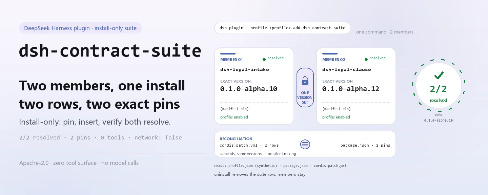
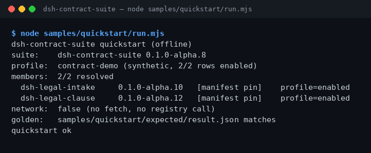

<div align="center">

<picture>
  <source media="(prefers-color-scheme: dark)" srcset="docs/assets/dsh-contract-suite-hero-en-dark.webp">
  
</picture>

# dsh-contract-suite

**एक ही कमांड से कॉन्ट्रैक्ट-लीगल दोनों पैकेज इंस्टॉल करें और तुरंत जाँचें कि हर सदस्य का संस्करण रिज़ॉल्व होता है।**

DeepSeek Harness के लिए सिर्फ़ इंस्टॉल करने वाली सूट: यह `dsh-legal-intake` (कॉन्ट्रैक्ट इनटेक) और `dsh-legal-clause` (क्लॉज़/playbook समीक्षा) को एक ही सटीक संस्करण-सेट पर पिन करके साथ इंस्टॉल करती है। सूट की अपनी कोई टूल सतह नहीं है — यह कॉन्ट्रैक्ट नहीं पढ़ती, नेटवर्क कॉल नहीं करती और मॉडल नहीं बुलाती।

[इंस्टॉल](#तीन-चरणों-में-शुरुआत) · [कॉन्फ़िगरेशन](#कॉन्फ़िगरेशन) · [FAQ](#faq) · [简体中文](README.md) · [English](README.en.md) · [Español](README.es.md) · [Português](README.pt.md) · [हिन्दी](README.hi.md)

[](LICENSE)
[](#संगतता)
[](https://www.npmjs.com/package/dsh-contract-suite)
[](https://github.com/PerryLink/dsh-contract-suite/actions/workflows/ci.yml)
[](#संगतता)

[](https://github.com/PerryLink/dsh-contract-suite/stargazers)
[](https://www.npmjs.com/package/dsh-contract-suite)
[](https://dshfind.com/plugins/PerryLink/dsh-contract-suite?ref=badge)
[](https://dsh.market/)
[](https://gitee.com/perrylink/dsh-plugins)

```sh
dsh plugin --profile <profile> add dsh-contract-suite
```

</div>

<sub>सामुदायिक सूट, DeepSeek से असंबद्ध। कैनोनिकल रिपॉज़िटरी: <https://github.com/PerryLink/dsh-contract-suite> (Apache-2.0)।</sub>

## यह क्या है

`dsh-contract-suite` एक **सिर्फ़ इंस्टॉल करने वाली सूट** है: यह कॉन्ट्रैक्ट की समीक्षा नहीं करती, बल्कि दोनों सदस्य पैकेजों को एक ही DSH प्रोफ़ाइल में इंस्टॉल करती है और उनके संस्करण पिन करती है। `package.json#dependencies` में `dsh-legal-intake` (कॉन्ट्रैक्ट इनटेक) और `dsh-legal-clause` (क्लॉज़/playbook समीक्षा) के सटीक संस्करण तय हैं, जबकि `cordis.patch.yml` दोनों सदस्य पंक्तियाँ जोड़ता है। इंस्टॉल के बाद बंडल किया गया ऑफ़लाइन नमूना चलाएँ — टर्मिनल हर सदस्य, उसका पिन किया संस्करण और रिज़ॉल्व होने का स्रोत दिखाता है; 2/2 resolved का मतलब है कि सेट पूरा है। कोई नेटवर्क नहीं, कोई मॉडल कॉल नहीं, कोई फ़ाइल नहीं लिखी जाती।

<picture>
  <source media="(prefers-color-scheme: dark)" srcset="docs/assets/dsh-contract-suite-flow-v5-dark.svg">
  
</picture>

## किसके लिए है / किसके लिए नहीं

- **इसके लिए है:** एक ही DSH प्रोफ़ाइल में कॉन्ट्रैक्ट इनटेक और क्लॉज़ समीक्षा इंस्टॉल करना; दोनों सदस्यों को एक ही पिन किए संस्करण-सेट पर रखना; इंस्टॉल के तुरंत बाद पुष्टि करना कि कोई सदस्य पंक्ति छूटी नहीं।
- **इसके लिए नहीं है:** सिर्फ़ एक पैकेज इंस्टॉल करना (वह सदस्य सीधे इंस्टॉल करें); सूट से कॉन्ट्रैक्ट की समीक्षा की उम्मीद करना (सूट की कोई टूल सतह नहीं — यह काम सदस्य करते हैं); OCR, बाहरी CLM या e-sign इंटीग्रेशन।

## इनपुट और आउटपुट

**इनपुट**

- इंस्टॉल स्वयं कोई बिज़नेस दस्तावेज़ नहीं पढ़ता।
- बंडल किया गया नमूना सिर्फ़ `samples/quickstart/input/profile.json` (सिंथेटिक प्रोफ़ाइल डंप, < 1 KB), इस पैकेज का `package.json` और `cordis.patch.yml` पढ़ता है। कोई अन्य डायरेक्टरी या ग्राहक कॉन्ट्रैक्ट नहीं पढ़ता।
- हर सदस्य का अपना इनपुट (कॉन्ट्रैक्ट टेक्स्ट, क्लॉज़ सूचियाँ, playbook) उस सदस्य के README में लिखा है; सूट उसे नहीं बदलती।

**आउटपुट**

- टर्मिनल सदस्य सूची, पिन किए संस्करण और हर संस्करण का रिज़ॉल्व स्रोत दिखाता है; 2/2 का मतलब है कि दोनों सदस्य रिज़ॉल्व होते हैं।
- `node samples/quickstart/run.mjs --json` गोल्डन JSON प्रिंट करता है जो `samples/quickstart/expected/result.json` में है; `--check` उससे फ़ील्ड-दर-फ़ील्ड तुलना करता है।
- कोई फ़ाइल नहीं लिखी जाती, कोई मॉडल नहीं बुलाया जाता, नेटवर्क इस्तेमाल नहीं होता, कुछ अपलोड नहीं होता और मूल कॉन्ट्रैक्ट छुए नहीं जाते।

## तीन चरणों में शुरुआत

1. **इंस्टॉल करें** (कोई एक चैनल चुनें):

   ```sh
   # npm चैनल (अनुशंसित, प्रकाशित संस्करण)
   dsh plugin --profile <profile> add dsh-contract-suite
   # git चैनल (नवीनतम main)
   dsh plugin --profile <profile> add github:PerryLink/dsh-contract-suite
   # tarball चैनल: इस रिपॉज़िटरी में pnpm pack के बाद
   dsh plugin --profile <profile> add ./dsh-contract-suite-<version>.tgz
   # 1024 स्टोर चैनल
   npm i -g dsh1024 && dsh1024 plugin --profile <profile> add dsh-contract-suite
   ```

   कोई बिल्ड चरण नहीं — शुद्ध ESM; `src/` और `samples/` ही प्रकाशित सामग्री हैं।

2. **असेंबल** (डिफ़ॉल्ट रूप से पहले से हो जाता है): बंडल `cordis.patch.yml` लागू करता है और दोनों सदस्य पंक्तियाँ प्रोफ़ाइल में जोड़ता है:

   ```yaml
   - insert:
       - id: dsh-legal-intake
         name: dsh-legal-intake
       - id: dsh-legal-clause
         name: dsh-legal-clause
   ```

   सूट में कोई कॉन्फ़िगरेशन कुंजी नहीं है; हर सदस्य का कॉन्फ़िगरेशन उसके अपने README में है।

3. **जाँचें कि लागू हुआ**:

   ```sh
   dsh --profile <profile> --dump-config | grep dsh-contract-suite
   node samples/quickstart/run.mjs
   ```

   वास्तविक आउटपुट (2026-11-05 को चलाया गया, सदस्य-रिज़ॉल्यूशन वाला हिस्सा):

   ```text
   dsh-contract-suite quickstart (offline)
   suite:    dsh-contract-suite 0.1.0-alpha.10
   profile:  contract-demo (synthetic, 2/2 rows enabled)
   members:  2/2 resolved
     dsh-legal-intake     0.1.0-alpha.10   [manifest pin]    profile=enabled
     dsh-legal-clause     0.1.0-alpha.12   [manifest pin]    profile=enabled
   network:  false (no fetch, no registry call)
   ```

**अनइंस्टॉल**: `dsh plugin --profile <profile> remove dsh-contract-suite` (या प्रोफ़ाइल patch से वह पंक्ति हटाएँ)। सूट हटाने से सिर्फ़ उसकी पंक्ति हटती है; सदस्य पैकेज इंस्टॉल रहते हैं।

## मुख्य क्षमताएँ

- **एक कमांड पूरा सेट इंस्टॉल करता है** — एक `dsh plugin add` दोनों सदस्य इंस्टॉल कर देता है, दो पैकेज नाम और संस्करण अलग-अलग याद रखने की ज़रूरत नहीं।
- **संस्करण साथ में लॉक** — सदस्यों के संस्करण `package.json#dependencies` में पिन हैं; किसी और संस्करण पर इंस्टॉल सदस्य `E_SUITE_VERSION_MISMATCH` देता है, चुपचाप मिली-जुली इंस्टॉल नहीं करता। सूट अपग्रेड करें, अलग सदस्य नहीं।
- **सदस्य-पंक्ति मिलान** — `cordis.patch.yml` और `dependencies` दोनों दिशाओं में जाँचे जाते हैं: पंक्ति कम, पंक्ति ज़्यादा, डुप्लिकेट id या `id`/`name` में अंतर → `E_SUITE_PATCH_MISMATCH`; मैनिफ़ेस्ट गायब या अमान्य JSON → `E_SUITE_MANIFEST_MISSING`।
- **ऑफ़लाइन स्व-जाँच** — `samples/quickstart/run.mjs` तीन फ़ाइलें पढ़ता है और सदस्य, पिन किए संस्करण तथा रिज़ॉल्व स्रोत दिखाता है; `--json` मशीन-पठनीय आउटपुट देता है और `--check` गोल्डन से तुलना करता है। शून्य नेटवर्क, शून्य लेखन।
- **कोई टूल सतह नहीं** — कोई टूल, कमांड, slot, HTTP रूट या सर्विस कुंजी पंजीकृत नहीं; सिर्फ़ दो सदस्य पंक्तियाँ जोड़ी जाती हैं। सदस्य स्वतंत्र रहते हैं और अलग से इंस्टॉल या हटाए जा सकते हैं।
- **पुनरुत्पाद्य साक्ष्य** — `ACCEPTANCE.csv` सार्वजनिक स्वीकृति पंक्तियाँ दर्ज करता है (`counted` बताता है कि पंक्ति गिनी जाती है या नहीं), `screenshots.json` स्क्रीनशॉट का कमांड, समय और SHA-256 दर्ज करता है, और `node scripts/acceptance.mjs` पंक्तियाँ फिर बनाता है।

## सदस्य और संस्करण

सूट सिर्फ़ इन सदस्यों को इंस्टॉल करती है और उसकी अपनी कोई टूल सतह नहीं है। संस्करण `dependencies` में पिन हैं।

| सदस्य | पिन किया संस्करण |
|---|---:|
| `dsh-legal-intake` | `0.1.0-alpha.10` |
| `dsh-legal-clause` | `0.1.0-alpha.12` |

सूट का वर्तमान संस्करण: `0.1.0-alpha.10` (`package.json` से मेल खाता है)।

## उदाहरण

यह वाक्य DSH में पेस्ट करें:

> कॉन्ट्रैक्ट-लीगल दोनों पैकेज (कॉन्ट्रैक्ट इनटेक और क्लॉज़ समीक्षा) इंस्टॉल करें, पुष्टि करें कि दोनों सदस्य पैकेज रिज़ॉल्व होते हैं, और हर संस्करण सूचीबद्ध करें।

फिर पैकेज डायरेक्टरी से बंडल किया नमूना चलाएँ (ऑफ़लाइन, डिपेंडेंसी इंस्टॉल किए बिना):

```sh
node samples/quickstart/run.mjs
```

वास्तविक आउटपुट «तीन चरणों में शुरुआत» के चरण 3 में है। स्क्रीनशॉट उसी कमांड का असली टर्मिनल आउटपुट है, 2026-11-02 को लिया गया (तब सूट संस्करण `0.1.0-alpha.8` था; सदस्य संस्करण अब जैसे हैं वैसे ही थे):



स्क्रीनशॉट मेटाडेटा (कमांड, समय, आउटपुट SHA-256) `screenshots.json` में है।

## कॉन्फ़िगरेशन

सूट एक सिर्फ़-इंस्टॉल बंडल है: **कोई Config स्कीमा नहीं और कोई रनटाइम कुंजी नहीं**। सिर्फ़ असेंबली सतह और इंस्टॉल लक्ष्य समायोज्य हैं:

| समायोज्य | कहाँ | वर्तमान मान | टिप्पणी |
|---|---|---|---|
| सदस्य सेट | `cordis.patch.yml` | `dsh-legal-intake`, `dsh-legal-clause` | हर सदस्य के लिए एक `id` + `name` पंक्ति; `dependencies` से बिल्कुल मेल खाना चाहिए |
| सदस्य संस्करण | `package.json#dependencies` | `0.1.0-alpha.10`, `0.1.0-alpha.12` | सटीक पिन; एक सदस्य अपग्रेड करने पर `E_SUITE_VERSION_MISMATCH` |
| इंस्टॉल लक्ष्य | `dsh plugin --profile <profile>` | आपकी पसंद | सूट सिर्फ़ बताई गई प्रोफ़ाइल में इंस्टॉल होती है |
| डेमो मेटाडेटा | `package.json#dsh.demo` | `sample` / `prompt` / `expect` / `screenshot` | ऑफ़लाइन नमूना, प्रॉम्प्ट और साक्ष्य पथ घोषित करता है |

हर सदस्य का कॉन्फ़िगरेशन (कॉन्ट्रैक्ट टेक्स्ट, क्लॉज़ सूचियाँ, playbook) उस सदस्य के README में है; सूट उसे न पढ़ती है, न बदलती है, और सदस्यों की कॉन्फ़िगरेशन पंक्तियाँ ओवरराइट नहीं करती।

<details>
<summary>पूरी असेंबली फ़ाइल (cordis.patch.yml)</summary>

```yaml
- insert:
    - id: dsh-legal-intake
      name: dsh-legal-intake
    - id: dsh-legal-clause
      name: dsh-legal-clause
```

</details>

<details>
<summary>इंस्टॉल चैनलों की तुलना</summary>

| चैनल | कमांड | कब उपयोग करें |
|---|---|---|
| npm (अनुशंसित) | `dsh plugin --profile <profile> add dsh-contract-suite` | प्रकाशित संस्करण से सामान्य इंस्टॉल |
| git | `dsh plugin --profile <profile> add github:PerryLink/dsh-contract-suite` | नवीनतम main को ट्रैक करना |
| tarball | `pnpm pack` के बाद `dsh plugin --profile <profile> add ./dsh-contract-suite-<version>.tgz` | ऑफ़लाइन या पिन किया आर्टिफ़ैक्ट |
| 1024 स्टोर | `npm i -g dsh1024` के बाद `dsh1024 plugin --profile <profile> add dsh-contract-suite` | 1024 चैनल से इंस्टॉल |

</details>

## FAQ

<details>
<summary>इंस्टॉल विफल होता है या बाद में एक सदस्य गायब है। अब क्या करें?</summary>

पहले `node samples/quickstart/run.mjs` चलाएँ। अगर दोनों सदस्य सूचियाँ अलग हैं तो `E_SUITE_PATCH_MISMATCH` आता है; [TROUBLESHOOTING.md](TROUBLESHOOTING.md) के अनुसार `cordis.patch.yml` को `dependencies` से मिलाएँ और फिर इंस्टॉल करें। मैनिफ़ेस्ट गायब या tarball अधूरा होने पर `E_SUITE_MANIFEST_MISSING` आता है; पैकेज रूट से दोबारा चलाएँ या फिर इंस्टॉल करें।

</details>

<details>
<summary>संस्करण सूट की घोषणा से मेल नहीं खाता। क्यों?</summary>

सूट सटीक सदस्य संस्करण पिन करती है और एक तय सेट का वादा करती है। एक सदस्य अलग से अपग्रेड करने पर, या `node_modules` में पुराना संस्करण छूटने पर `E_SUITE_VERSION_MISMATCH` आता है। उस प्रोफ़ाइल में `node_modules` हटाकर सूट फिर इंस्टॉल करें; अगर सचमुच नया सदस्य संस्करण चाहिए तो उसे पिन करने वाली नई सूट का इंतज़ार करें — सिर्फ़ सदस्य अपग्रेड न करें।

</details>

<details>
<summary>क्या सूट मेरे कॉन्ट्रैक्ट की समीक्षा कर सकती है?</summary>

नहीं। सूट सिर्फ़ सदस्य इंस्टॉल करती है और उसकी अपनी कोई टूल सतह नहीं है; कॉन्ट्रैक्ट इनटेक और क्लॉज़ समीक्षा सदस्य पैकेजों के टूल से होती है। बंडल किया नमूना सिंथेटिक प्रोफ़ाइल इस्तेमाल करता है, असली कॉन्ट्रैक्ट नहीं पढ़ता और कोई समीक्षा नतीजा नहीं देता।

</details>

<details>
<summary>क्या सूट अनइंस्टॉल करने से सदस्य भी हट जाते हैं?</summary>

नहीं। सूट हटाने से सिर्फ़ उसकी पंक्ति हटती है; सदस्य पैकेज तब तक इंस्टॉल रहते हैं जब तक आप उन्हें अलग-अलग न हटाएँ। सदस्य स्वतंत्र Cordis पंक्तियाँ हैं और सूट के बिना भी इंस्टॉल किए जा सकते हैं।

</details>

<details>
<summary>डेटा कहाँ रहता है? क्या यह नेटवर्क पर जाता है या कुछ अपलोड करता है?</summary>

इंस्टॉल कोई बिज़नेस दस्तावेज़ नहीं पढ़ता; बंडल किया नमूना सिर्फ़ तीन फ़ाइलें पढ़ता है: `samples/quickstart/input/profile.json`, `cordis.patch.yml` और `package.json`। यह कोई फ़ाइल नहीं लिखता, नेटवर्क इस्तेमाल नहीं करता, कुछ अपलोड नहीं करता और मॉडल नहीं बुलाता। नेटवर्क वाला एकमात्र हिस्सा डेवलपर-पक्ष का `scripts/check.mjs` है (यह रजिस्ट्री से पुष्टि करता है कि सदस्य संस्करण मौजूद हैं); वह इंस्टॉल या रनटाइम पर नहीं चलता।

</details>

## अनुमतियाँ और डेटा

- पढ़ना: `samples/quickstart/input/profile.json`, `cordis.patch.yml`, `package.json`; कोई अन्य डायरेक्टरी नहीं
- लिखना: कुछ नहीं (R0 — सिर्फ़ टर्मिनल आउटपुट; `$DSH_HOME` में कोई लेखन नहीं, मूल फ़ाइलें अछूती)
- नेटवर्क: नहीं
- बाहरी सिस्टम: कोई नहीं
- सिर्फ़ सार्वजनिक/सिंथेटिक fixtures; कोई ग्राहक डेटा नहीं और कोई ग्राहक साक्ष्य नहीं।
- Alpha/partial; not counted, GA या उत्पादन-तैयारी का कोई दावा नहीं।

## सुरक्षा सीमाएँ

- **सिर्फ़ इंस्टॉल; किसी सामग्री को प्रोसेस नहीं करती।** सूट की कोई टूल सतह या कमांड नहीं है, और यह कोई slot या HTTP रूट पंजीकृत नहीं करती; कॉन्ट्रैक्ट सामग्री सदस्य पैकेजों और आपके लोकल परिवेश में ही रहती है।
- **सार्वजनिक/सिंथेटिक नमूने।** रिपॉज़िटरी में सिर्फ़ सार्वजनिक या सिंथेटिक fixtures हैं; कोई ग्राहक डेटा, ग्राहक कॉन्ट्रैक्ट या ग्राहक साक्ष्य नहीं, और उत्पादन-तैयारी का कोई दावा नहीं।
- **फ़ेल-क्लोज़्ड।** मैनिफ़ेस्ट गायब, patch और dependencies में अंतर, या सदस्य संस्करण का विचलन लोड/स्व-जाँच के समय स्पष्ट `E_` कोड के साथ विफल होता है — कभी चुपचाप डाउनग्रेड या मिली-जुली इंस्टॉल नहीं।
- **सदस्य कॉन्फ़िगरेशन कभी नहीं बदलती।** बंडल patch सिर्फ़ अपनी दो पंक्तियाँ `insert` करता है; अंदरूनी या सदस्य पंक्तियों का `config` ओवरराइट नहीं करता।
- **न्यूनतम विशेषाधिकार।** इंस्टॉल `$DSH_HOME` नहीं लिखता और स्रोत फ़ाइलें नहीं छूता; हर सदस्य टूल की अनुमति और डेटा सीमाएँ उसके रिपॉज़िटरी और `ACCEPTANCE` में दर्ज हैं।

## ज्ञात सीमाएँ

- **सिर्फ़ इंस्टॉल।** सूट की अपनी कोई टूल सतह नहीं; यह कॉन्ट्रैक्ट की समीक्षा नहीं कर सकती और OCR, बाहरी CLM या e-sign इंटीग्रेशन नहीं देती। ये क्षमताएँ (जहाँ मौजूद हैं) सदस्यों की हैं।
- **Alpha / partial / not counted।** GA या उत्पादन-तैयारी का कोई दावा नहीं; `counted=false` वाली सार्वजनिक स्वीकृति पंक्तियाँ औपचारिक स्वीकृति में नहीं गिनी जातीं।
- **संस्करण सूट रिलीज़ तय करती है।** सदस्य पिन होने पर अकेले सदस्य को अपग्रेड करना विफल होता है; सदस्य संस्करण बदलने के लिए नई सूट रिलीज़ चाहिए।
- **नमूने का गोल्डन एक रिलीज़ पीछे है।** `samples/quickstart/expected/result.json` में अभी `0.1.0-alpha.8` दर्ज है, जबकि वर्तमान पैकेज `0.1.0-alpha.10` है; इसलिए `run.mjs --check` और उस पर निर्भर टेस्ट गोल्डन-मेल न होने की शिकायत करते हैं। `run.mjs --json` को सत्य मानें और जाँच बहाल करने के लिए गोल्डन फिर बनाएँ। इसका इंस्टॉल या सदस्य-रिज़ॉल्यूशन पर कोई असर नहीं।
- **कोई कॉन्फ़िगरेशन कुंजी नहीं।** हर सदस्य के समायोजन उसके README में हैं; सूट कोई अतिरिक्त स्विच नहीं देती।

## अन्य DSH प्लगइनों के साथ इंटरऑपरेबिलिटी

- **कोई साझा सर्विस, पोर्ट या स्टोरेज डोमेन नहीं।** सूट और उसके सदस्य कोई साझा service, port या storage domain नहीं लेते; सदस्य स्वतंत्र Cordis पंक्तियाँ हैं।
- **कोई टूल/कमांड/slot/रूट पंजीकरण नहीं।** सूट कोई टूल, कमांड, क्लाइंट slot या `webServer` प्रीफ़िक्स पंजीकृत नहीं करती, इसलिए नाम-टकराव या slot की होड़ नहीं।
- **सिर्फ़ जोड़ना, कभी ओवरराइट नहीं।** बंडल patch सिर्फ़ सदस्य पंक्तियाँ `insert` करता है; अंदरूनी या सदस्य पंक्तियों का `config` ओवरराइट नहीं करता।
- **अलग से इंस्टॉल हो सकते हैं।** सदस्य सूट के बिना इंस्टॉल और अनइंस्टॉल किए जा सकते हैं; सूट हटाने से वे नहीं हटते।
- **चैनल-स्वतंत्र।** npm, git, tarball और 1024 स्टोर — सब एक ही सदस्य सेट और संस्करण देते हैं।

## संगतता

| सतह | स्थिति |
|---|---|
| Harness | `dsh >=0.2.1-rc.3 <0.3.0` |
| Node | `>=24.9.0 <25` |
| प्लेटफ़ॉर्म | DSH के सभी समर्थित प्लेटफ़ॉर्म; सिर्फ़ लोकल फ़ाइलें |
| डेटा | कोई नेटवर्क नहीं, कोई मॉडल कॉल नहीं, कोई अपलोड नहीं |

## इकोसिस्टम और गुणवत्ता

- [डोमेन इंडेक्स](https://perrylink.github.io/dsh-plugins/) (पैकेज कैटलॉग और इंस्टॉल एंट्री)
- [Checker परिवार](https://perrylink.github.io/zh/checkers/) (चेकर प्लगइन का अवलोकन)
- [मुख्य परिवार](https://github.com/PerryLink/dsh-kit) (इंस्टॉल spec और परिवार सूची)
- [Gitee एग्रीगेट मिरर](https://gitee.com/perrylink/dsh-plugins) (GitHub ही कैनोनिकल है)
- [dshfind प्लगइन पेज](https://dshfind.com/plugins/PerryLink/dsh-contract-suite) (इंस्टॉल और रैंकिंग)
- [DSH Market](https://dsh.market/) (सूचीबद्ध)
- **1024 स्टोर चैनल**: पहले `npm i -g dsh1024`, फिर `dsh1024 plugin --profile <profile> add dsh-contract-suite` ([deepseek1024.com](https://deepseek1024.com) की इंस्टॉल रैंकिंग में गिना जाता है)
- **साक्ष्य फ़ाइलें**: [`ACCEPTANCE.csv`](ACCEPTANCE.csv) · [`screenshots.json`](screenshots.json) · [`samples/quickstart/expected/result.json`](samples/quickstart/expected/result.json)

## डेवलपमेंट

```sh
pnpm install --frozen-lockfile
pnpm quickstart        # node samples/quickstart/run.mjs
pnpm test              # node --test test/suite.test.mjs
pnpm gate              # node scripts/gate.mjs (ऑफ़लाइन रिलीज़ गेट)
pnpm check             # node scripts/check.mjs (रजिस्ट्री जाँच, सिर्फ़ CI)
```

कोई बिल्ड चरण नहीं: प्रकाशित सामग्री `src/` + `samples/` + `cordis.patch.yml` है।

| पथ | उद्देश्य |
|---|---|
| `src/members.mjs` | एकमात्र रनटाइम कोड: `package.json` + `cordis.patch.yml` पढ़ता है, सदस्य जाँचता है और संस्करण रिज़ॉल्व करता है |
| `samples/quickstart/` | ऑफ़लाइन नमूना: `input/profile.json`, `expected/result.json`, `run.mjs` |
| `test/suite.test.mjs` | `node --test`: मैनिफ़ेस्ट, नमूना, गोल्डन, त्रुटि शाखाएँ |
| `scripts/gate.mjs` | रिलीज़ गेट: मैनिफ़ेस्ट, नमूना, डॉक ब्लॉक, साक्ष्य, गोल्डन, टेस्ट |
| `scripts/check.mjs` | रजिस्ट्री के विरुद्ध इंस्टॉल स्मोक (सिर्फ़ CI; एकमात्र नेटवर्क वाला स्क्रिप्ट) |
| `scripts/acceptance.mjs` | असली लोकल जाँचों से `ACCEPTANCE.csv` फिर बनाता है |
| `scripts/gen-readme-assets.py` | README चित्र बनाता है (Python + Pillow) |
| `docs/assets/` | फ़्लो डायग्राम और quickstart स्क्रीनशॉट |
| `cordis.patch.yml` | सदस्य असेंबली सतह (दो `insert` पंक्तियाँ) |

चित्र [`scripts/gen-readme-assets.py`](scripts/gen-readme-assets.py) से बनते हैं: `python scripts/gen-readme-assets.py` `docs/assets/dsh-contract-suite-hero-{zh,en}-{light,dark}.webp` (बैनर) और `docs/assets/dsh-contract-suite-flow-v5-{light,dark}.svg` (संरचना चित्र, वेक्टर, पाँचों भाषाओं में साझा) लिखता है, तथा पुराने `dsh-contract-suite-flow-{light,dark}.svg` और एकल `dsh-contract-suite-flow.svg` को अछूता छोड़ता है। स्क्रिप्ट दोबारा चलाई जा सकती है।

पाँच भाषाओं के README: `README.md` चीनी स्रोत है; `README.en.md`, `README.es.md`, `README.pt.md` और `README.hi.md` उसका अनुसरण करते हैं।

Topics: `dsh`, `deepseek-harness`, `dsh-plugin`, `dsh-bundle`, `perrylink`, `suite`, `legal`

## परिवार और आभार

यह प्रोजेक्ट [PerryLink](https://github.com/PerryLink) के DeepSeek Harness प्लगइन परिवार का सदस्य है (सभी Apache-2.0)। अगर यह सूट आपके काम आए तो **एक स्टार दें** — इससे कोई सुविधा खुलती नहीं, लेकिन अगला व्यक्ति इसे आसानी से ढूँढ पाता है।

- [dsh-legal-intake](https://github.com/PerryLink/dsh-legal-intake) — कॉन्ट्रैक्ट इनटेक सदस्य।
- [dsh-legal-clause](https://github.com/PerryLink/dsh-legal-clause) — क्लॉज़/playbook समीक्षा सदस्य।
- [@PerryLink](https://github.com/PerryLink) — निर्माता और अनुरक्षक: सूट कॉन्ट्रैक्ट, संस्करण पिनिंग, ऑफ़लाइन quickstart, स्वीकृति पंक्तियाँ और पाँच-भाषा दस्तावेज़।

<details>
<summary>DSH डोमेन प्लगइन परिवार (15 पैकेज + 2 सुइट)</summary>

| Package | npm |
|---|---|
| **[dsh-einvoice](https://github.com/PerryLink/dsh-einvoice)** | [npm](https://www.npmjs.com/package/dsh-einvoice) |
| **[dsh-docx-redline](https://github.com/PerryLink/dsh-docx-redline)** | [npm](https://www.npmjs.com/package/dsh-docx-redline) |
| **[dsh-policy-ledger](https://github.com/PerryLink/dsh-policy-ledger)** | [npm](https://www.npmjs.com/package/dsh-policy-ledger) |
| **[dsh-ghg](https://github.com/PerryLink/dsh-ghg)** | [npm](https://www.npmjs.com/package/dsh-ghg) |
| **[dsh-bankrec](https://github.com/PerryLink/dsh-bankrec)** | [npm](https://www.npmjs.com/package/dsh-bankrec) |
| **[dsh-ap-three-way](https://github.com/PerryLink/dsh-ap-three-way)** | [npm](https://www.npmjs.com/package/dsh-ap-three-way) |
| **[dsh-ifc-qto](https://github.com/PerryLink/dsh-ifc-qto)** | [npm](https://www.npmjs.com/package/dsh-ifc-qto) |
| **[dsh-qms-capa](https://github.com/PerryLink/dsh-qms-capa)** | [npm](https://www.npmjs.com/package/dsh-qms-capa) |
| **[dsh-legal-intake](https://github.com/PerryLink/dsh-legal-intake)** | [npm](https://www.npmjs.com/package/dsh-legal-intake) |
| **[dsh-legal-clause](https://github.com/PerryLink/dsh-legal-clause)** | [npm](https://www.npmjs.com/package/dsh-legal-clause) |
| **[dsh-freight-audit](https://github.com/PerryLink/dsh-freight-audit)** | [npm](https://www.npmjs.com/package/dsh-freight-audit) |
| **[dsh-hs-candidate](https://github.com/PerryLink/dsh-hs-candidate)** | [npm](https://www.npmjs.com/package/dsh-hs-candidate) |
| **[dsh-travel-recon](https://github.com/PerryLink/dsh-travel-recon)** | [npm](https://www.npmjs.com/package/dsh-travel-recon) |
| **[dsh-pim-lint](https://github.com/PerryLink/dsh-pim-lint)** | [npm](https://www.npmjs.com/package/dsh-pim-lint) |
| **[dsh-eval-pack](https://github.com/PerryLink/dsh-eval-pack)** | [npm](https://www.npmjs.com/package/dsh-eval-pack) |
| **[dsh-finops-suite](https://github.com/PerryLink/dsh-finops-suite)** | [npm](https://www.npmjs.com/package/dsh-finops-suite) |
| **[dsh-contract-suite](https://github.com/PerryLink/dsh-contract-suite)** | [npm](https://www.npmjs.com/package/dsh-contract-suite) |

</details>

<details>
<summary>मुख्य परिवार — 87 वर्तमान इंस्टॉल स्पेक</summary>

| Package | npm |
|---|---|
| **[dsh-aqua-input-check](https://github.com/PerryLink/dsh-aqua-input-check)** | [npm](https://www.npmjs.com/package/dsh-aqua-input-check) |
| **[dsh-archive-check](https://github.com/PerryLink/dsh-archive-check)** | [npm](https://www.npmjs.com/package/dsh-archive-check) |
| **[dsh-bid-ca-precheck](https://github.com/PerryLink/dsh-bid-ca-precheck)** | [npm](https://www.npmjs.com/package/dsh-bid-ca-precheck) |
| **[dsh-bid-qual-check](https://github.com/PerryLink/dsh-bid-qual-check)** | [npm](https://www.npmjs.com/package/dsh-bid-qual-check) |
| **[dsh-contract-stance](https://github.com/PerryLink/dsh-contract-stance)** | [npm](https://www.npmjs.com/package/dsh-contract-stance) |
| **[dsh-customs-doc-check](https://github.com/PerryLink/dsh-customs-doc-check)** | [npm](https://www.npmjs.com/package/dsh-customs-doc-check) |
| **[dsh-demurrage-ledger](https://github.com/PerryLink/dsh-demurrage-ledger)** | [npm](https://www.npmjs.com/package/dsh-demurrage-ledger) |
| **[dsh-drill-script-check](https://github.com/PerryLink/dsh-drill-script-check)** | [npm](https://www.npmjs.com/package/dsh-drill-script-check) |
| **[dsh-eia-guide-check](https://github.com/PerryLink/dsh-eia-guide-check)** | [npm](https://www.npmjs.com/package/dsh-eia-guide-check) |
| **[dsh-emergency-plan](https://github.com/PerryLink/dsh-emergency-plan)** | [npm](https://www.npmjs.com/package/dsh-emergency-plan) |
| **[dsh-essay-rubric-check](https://github.com/PerryLink/dsh-essay-rubric-check)** | [npm](https://www.npmjs.com/package/dsh-essay-rubric-check) |
| **[dsh-evidence-check](https://github.com/PerryLink/dsh-evidence-check)** | [npm](https://www.npmjs.com/package/dsh-evidence-check) |
| **[dsh-export-ctl-check](https://github.com/PerryLink/dsh-export-ctl-check)** | [npm](https://www.npmjs.com/package/dsh-export-ctl-check) |
| **[dsh-fmea-table-check](https://github.com/PerryLink/dsh-fmea-table-check)** | [npm](https://www.npmjs.com/package/dsh-fmea-table-check) |
| **[dsh-forecast-penalty](https://github.com/PerryLink/dsh-forecast-penalty)** | [npm](https://www.npmjs.com/package/dsh-forecast-penalty) |
| **[dsh-gongwen-flow-check](https://github.com/PerryLink/dsh-gongwen-flow-check)** | [npm](https://www.npmjs.com/package/dsh-gongwen-flow-check) |
| **[dsh-gongwen-word-check](https://github.com/PerryLink/dsh-gongwen-word-check)** | [npm](https://www.npmjs.com/package/dsh-gongwen-word-check) |
| **[dsh-guard-plan-qc](https://github.com/PerryLink/dsh-guard-plan-qc)** | [npm](https://www.npmjs.com/package/dsh-guard-plan-qc) |
| **[dsh-hazchem-check](https://github.com/PerryLink/dsh-hazchem-check)** | [npm](https://www.npmjs.com/package/dsh-hazchem-check) |
| **[dsh-hazplan-check](https://github.com/PerryLink/dsh-hazplan-check)** | [npm](https://www.npmjs.com/package/dsh-hazplan-check) |
| **[dsh-hidden-risk-map](https://github.com/PerryLink/dsh-hidden-risk-map)** | [npm](https://www.npmjs.com/package/dsh-hidden-risk-map) |
| **[dsh-hs-classify](https://github.com/PerryLink/dsh-hs-classify)** | [npm](https://www.npmjs.com/package/dsh-hs-classify) |
| **[dsh-icd-rule-check](https://github.com/PerryLink/dsh-icd-rule-check)** | [npm](https://www.npmjs.com/package/dsh-icd-rule-check) |
| **[dsh-lawcite-adapter](https://github.com/PerryLink/dsh-lawcite-adapter)** | [npm](https://www.npmjs.com/package/dsh-lawcite-adapter) |
| **[dsh-lc-doc-check](https://github.com/PerryLink/dsh-lc-doc-check)** | [npm](https://www.npmjs.com/package/dsh-lc-doc-check) |
| **[dsh-learning-gap-check](https://github.com/PerryLink/dsh-learning-gap-check)** | [npm](https://www.npmjs.com/package/dsh-learning-gap-check) |
| **[dsh-medrec-qc](https://github.com/PerryLink/dsh-medrec-qc)** | [npm](https://www.npmjs.com/package/dsh-medrec-qc) |
| **[dsh-nsfc-form-check](https://github.com/PerryLink/dsh-nsfc-form-check)** | [npm](https://www.npmjs.com/package/dsh-nsfc-form-check) |
| **[dsh-nurse-record-check](https://github.com/PerryLink/dsh-nurse-record-check)** | [npm](https://www.npmjs.com/package/dsh-nurse-record-check) |
| **[dsh-origin-rvc-check](https://github.com/PerryLink/dsh-origin-rvc-check)** | [npm](https://www.npmjs.com/package/dsh-origin-rvc-check) |
| **[dsh-ota-review-check](https://github.com/PerryLink/dsh-ota-review-check)** | [npm](https://www.npmjs.com/package/dsh-ota-review-check) |
| **[dsh-paper-doc-adapter](https://github.com/PerryLink/dsh-paper-doc-adapter)** | [npm](https://www.npmjs.com/package/dsh-paper-doc-adapter) |
| **[dsh-permit-report-check](https://github.com/PerryLink/dsh-permit-report-check)** | [npm](https://www.npmjs.com/package/dsh-permit-report-check) |
| **[dsh-pipeline-check](https://github.com/PerryLink/dsh-pipeline-check)** | [npm](https://www.npmjs.com/package/dsh-pipeline-check) |
| **[dsh-pleading-draft](https://github.com/PerryLink/dsh-pleading-draft)** | [npm](https://www.npmjs.com/package/dsh-pleading-draft) |
| **[dsh-policy-brief-draft](https://github.com/PerryLink/dsh-policy-brief-draft)** | [npm](https://www.npmjs.com/package/dsh-policy-brief-draft) |
| **[dsh-power-loss-split](https://github.com/PerryLink/dsh-power-loss-split)** | [npm](https://www.npmjs.com/package/dsh-power-loss-split) |
| **[dsh-power-ticket-check](https://github.com/PerryLink/dsh-power-ticket-check)** | [npm](https://www.npmjs.com/package/dsh-power-ticket-check) |
| **[dsh-ppap-check](https://github.com/PerryLink/dsh-ppap-check)** | [npm](https://www.npmjs.com/package/dsh-ppap-check) |
| **[dsh-protest-deadline](https://github.com/PerryLink/dsh-protest-deadline)** | [npm](https://www.npmjs.com/package/dsh-protest-deadline) |
| **[dsh-railway-window](https://github.com/PerryLink/dsh-railway-window)** | [npm](https://www.npmjs.com/package/dsh-railway-window) |
| **[dsh-repair-order-qc](https://github.com/PerryLink/dsh-repair-order-qc)** | [npm](https://www.npmjs.com/package/dsh-repair-order-qc) |
| **[dsh-review-reply-check](https://github.com/PerryLink/dsh-review-reply-check)** | [npm](https://www.npmjs.com/package/dsh-review-reply-check) |
| **[dsh-rulefile-check](https://github.com/PerryLink/dsh-rulefile-check)** | [npm](https://www.npmjs.com/package/dsh-rulefile-check) |
| **[dsh-safety-brief-check](https://github.com/PerryLink/dsh-safety-brief-check)** | [npm](https://www.npmjs.com/package/dsh-safety-brief-check) |
| **[dsh-site-log-check](https://github.com/PerryLink/dsh-site-log-check)** | [npm](https://www.npmjs.com/package/dsh-site-log-check) |
| **[dsh-soe-decision-check](https://github.com/PerryLink/dsh-soe-decision-check)** | [npm](https://www.npmjs.com/package/dsh-soe-decision-check) |
| **[dsh-soilwater-check](https://github.com/PerryLink/dsh-soilwater-check)** | [npm](https://www.npmjs.com/package/dsh-soilwater-check) |
| **[dsh-sop-sync-check](https://github.com/PerryLink/dsh-sop-sync-check)** | [npm](https://www.npmjs.com/package/dsh-sop-sync-check) |
| **[dsh-spc-gbt-adapter](https://github.com/PerryLink/dsh-spc-gbt-adapter)** | [npm](https://www.npmjs.com/package/dsh-spc-gbt-adapter) |
| **[dsh-tender-extract](https://github.com/PerryLink/dsh-tender-extract)** | [npm](https://www.npmjs.com/package/dsh-tender-extract) |
| **[dsh-tender-matrix](https://github.com/PerryLink/dsh-tender-matrix)** | [npm](https://www.npmjs.com/package/dsh-tender-matrix) |
| **[dsh-warranty-calc](https://github.com/PerryLink/dsh-warranty-calc)** | [npm](https://www.npmjs.com/package/dsh-warranty-calc) |
| **[dsh-auto-review](https://github.com/PerryLink/dsh-auto-review)** | [npm](https://www.npmjs.com/package/dsh-auto-review) |
| **[dsh-autotier](https://github.com/PerryLink/dsh-autotier)** | [npm](https://www.npmjs.com/package/dsh-autotier) |
| **[dsh-budget](https://github.com/PerryLink/dsh-budget)** | [npm](https://www.npmjs.com/package/dsh-budget) |
| **[dsh-cert-mcp](https://github.com/PerryLink/dsh-cert-mcp)** | [npm](https://www.npmjs.com/package/dsh-cert-mcp) |
| **[dsh-checkpoint-rewind](https://github.com/PerryLink/dsh-checkpoint-rewind)** | [npm](https://www.npmjs.com/package/dsh-checkpoint-rewind) |
| **[dsh-claude-move](https://github.com/PerryLink/dsh-claude-move)** | [npm](https://www.npmjs.com/package/dsh-claude-move) |
| **[dsh-click](https://github.com/PerryLink/dsh-click)** | [npm](https://www.npmjs.com/package/dsh-click) |
| **[dsh-composer-history](https://github.com/PerryLink/dsh-composer-history)** | [npm](https://www.npmjs.com/package/dsh-composer-history) |
| **[dsh-data-quality](https://github.com/PerryLink/dsh-data-quality)** | [npm](https://www.npmjs.com/package/dsh-data-quality) |
| **[dsh-defend](https://github.com/PerryLink/dsh-defend)** | [npm](https://www.npmjs.com/package/dsh-defend) |
| **[dsh-doublecheck](https://github.com/PerryLink/dsh-doublecheck)** | [npm](https://www.npmjs.com/package/dsh-doublecheck) |
| **[dsh-draw](https://github.com/PerryLink/dsh-draw)** | [npm](https://www.npmjs.com/package/dsh-draw) |
| **[dsh-fast](https://github.com/PerryLink/dsh-fast)** | [npm](https://www.npmjs.com/package/dsh-fast) |
| **[dsh-fund-research](https://github.com/PerryLink/dsh-fund-research)** | [npm](https://www.npmjs.com/package/dsh-fund-research) |
| **[dsh-industry-research](https://github.com/PerryLink/dsh-industry-research)** | [npm](https://www.npmjs.com/package/dsh-industry-research) |
| **[dsh-laya](https://github.com/PerryLink/dsh-laya)** | [npm](https://www.npmjs.com/package/dsh-laya) |
| **[dsh-library](https://github.com/PerryLink/dsh-library)** | [npm](https://www.npmjs.com/package/dsh-library) |
| **[dsh-local-ai](https://github.com/PerryLink/dsh-local-ai)** | [npm](https://www.npmjs.com/package/dsh-local-ai) |
| **[dsh-lsp-actions](https://github.com/PerryLink/dsh-lsp-actions)** | [npm](https://www.npmjs.com/package/dsh-lsp-actions) |
| **[dsh-mask](https://github.com/PerryLink/dsh-mask)** | [npm](https://www.npmjs.com/package/dsh-mask) |
| **[dsh-mcp-panel](https://github.com/PerryLink/dsh-mcp-panel)** | [npm](https://www.npmjs.com/package/dsh-mcp-panel) |
| **[dsh-memento](https://github.com/PerryLink/dsh-memento)** | [npm](https://www.npmjs.com/package/dsh-memento) |
| **[dsh-observe](https://github.com/PerryLink/dsh-observe)** | [npm](https://www.npmjs.com/package/dsh-observe) |
| **[dsh-output-styles](https://github.com/PerryLink/dsh-output-styles)** | [npm](https://www.npmjs.com/package/dsh-output-styles) |
| **[dsh-permission-rules](https://github.com/PerryLink/dsh-permission-rules)** | [npm](https://www.npmjs.com/package/dsh-permission-rules) |
| **[dsh-plugin-guide](https://github.com/PerryLink/dsh-plugin-guide)** | [npm](https://www.npmjs.com/package/dsh-plugin-guide) |
| **[dsh-plugin-upgrade](https://github.com/PerryLink/dsh-plugin-upgrade)** | [npm](https://www.npmjs.com/package/dsh-plugin-upgrade) |
| **[dsh-reach](https://github.com/PerryLink/dsh-reach)** | [npm](https://www.npmjs.com/package/dsh-reach) |
| **[dsh-research-report](https://github.com/PerryLink/dsh-research-report)** | [npm](https://www.npmjs.com/package/dsh-research-report) |
| **[dsh-score](https://github.com/PerryLink/dsh-score)** | [npm](https://www.npmjs.com/package/dsh-score) |
| **[dsh-session-sync](https://github.com/PerryLink/dsh-session-sync)** | [npm](https://www.npmjs.com/package/dsh-session-sync) |
| **[dsh-talk](https://github.com/PerryLink/dsh-talk)** | [npm](https://www.npmjs.com/package/dsh-talk) |
| **[dsh-test-drive](https://github.com/PerryLink/dsh-test-drive)** | [npm](https://www.npmjs.com/package/dsh-test-drive) |
| **[dsh-translate](https://github.com/PerryLink/dsh-translate)** | [npm](https://www.npmjs.com/package/dsh-translate) |

</details>

## लाइसेंस

[LICENSE](LICENSE) (Apache License 2.0) © 2026 dsh-contract-suite contributors

<p align="center"><sub>Apache-2.0 · सामुदायिक सूट, DeepSeek से असंबद्ध।</sub></p>
