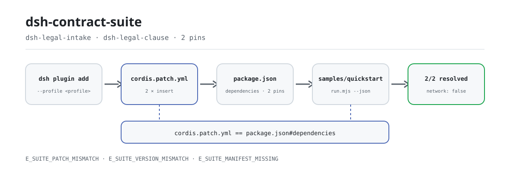
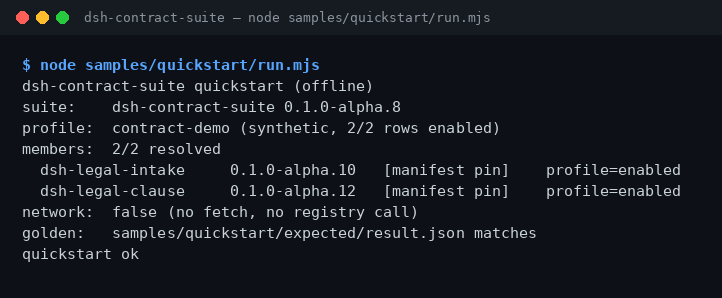

<div align="center">

<picture>
  <source media="(prefers-color-scheme: dark)" srcset="docs/assets/dsh-contract-suite-flow-dark.svg">
  
</picture>

# dsh-contract-suite

**一条命令装齐合同法务两件套，装完立刻核对两个成员版本是否都能解析。**

面向 DeepSeek Harness 的纯安装型套件：把合同需求收件（`dsh-legal-intake`）与条款/playbook 审查（`dsh-legal-clause`）钉在同一组精确版本上一起装；套件本身没有工具面，不读合同、不联网、不调用模型。

[安装](#三步上手) · [配置](#配置) · [FAQ](#faq) · [简体中文](README.md) · [English](README.en.md) · [Español](README.es.md) · [Português](README.pt.md) · [हिन्दी](README.hi.md)

[](LICENSE)
[](#兼容性)
[](https://www.npmjs.com/package/dsh-contract-suite)
[](https://github.com/PerryLink/dsh-contract-suite/actions/workflows/ci.yml)
[](#兼容性)

[](https://github.com/PerryLink/dsh-contract-suite/stargazers)
[](https://www.npmjs.com/package/dsh-contract-suite)
[](https://dshfind.com/plugins/PerryLink/dsh-contract-suite?ref=badge)
[](https://dsh.market/)
[](https://gitee.com/perrylink/dsh-plugins)

```sh
dsh plugin --profile <profile> add dsh-contract-suite
```

</div>

<sub>社区套件，与 DeepSeek 官方无关。唯一官方仓库：<https://github.com/PerryLink/dsh-contract-suite>（Apache-2.0）。</sub>

## 它是什么

`dsh-contract-suite` 是一个 **install-only 套件**：它不审合同，只负责把两个成员包一次性装进同一个 DSH profile，并把版本钉死。`package.json#dependencies` 固定 `dsh-legal-intake`（合同需求收件）与 `dsh-legal-clause`（条款/playbook 审查）的精确版本，`cordis.patch.yml` 固定插入两行成员。安装后跑自带离线样例，终端逐行给出成员、固定版本与解析结果——2/2 resolved 才算装全。全程不联网、不调用模型、不写文件。

## 适合与不适合

- **适合**：在同一个 DSH profile 里同时装合同录入与条款审查；需要把两个成员锁在同一组版本；装完先确认成员行一个不少。
- **不适合**：只想装其中一件（直接装对应成员包更轻）；想让 suite 自己审合同（suite 没有工具面，审查由成员包完成）；需要 OCR、外部 CLM 或 e-sign 对接。

## 输入与输出

**输入**

- 安装动作本身不读业务单据。
- 自带样例只读 `samples/quickstart/input/profile.json`（合成 profile dump，< 1 KB）、本包 `package.json` 与 `cordis.patch.yml`；不读其他目录、不读客户合同。
- 成员包各自的输入（合同文本、条款清单、playbook）见成员仓库 README；本 suite 不改变它们的输入输出。

**输出**

- 终端给出成员清单、固定版本、解析来源；2/2 表示两个成员都可解析。
- `node samples/quickstart/run.mjs --json` 输出金标 JSON，文件在 `samples/quickstart/expected/result.json`；`--check` 与金标逐字段比对。
- 不写任何文件、不调用模型、不联网、不上传；不改动原合同。

## 三步上手

1. **安装**（四选一）：

   ```sh
   # npm 通道（推荐，已发布版本）
   dsh plugin --profile <profile> add dsh-contract-suite
   # git 通道（最新 main）
   dsh plugin --profile <profile> add github:PerryLink/dsh-contract-suite
   # tarball 通道：本仓库 pnpm pack 后
   dsh plugin --profile <profile> add ./dsh-contract-suite-<version>.tgz
   # 1024 商店通道
   npm i -g dsh1024 && dsh1024 plugin --profile <profile> add dsh-contract-suite
   ```

   无构建步骤——纯 ESM，`src/` 与 `samples/` 即发布内容。

2. **装配**（默认即完成）：bundle 自动应用 `cordis.patch.yml`，两行成员进入 profile：

   ```yaml
   - insert:
       - id: dsh-legal-intake
         name: dsh-legal-intake
       - id: dsh-legal-clause
         name: dsh-legal-clause
   ```

   套件没有配置键；成员各自的配置见成员仓库 README。

3. **验证已生效**：

   ```sh
   dsh --profile <profile> --dump-config | grep dsh-contract-suite
   node samples/quickstart/run.mjs
   ```

   真实输出（2026-11-05 实跑，成员解析段）：

   ```text
   dsh-contract-suite quickstart (offline)
   suite:    dsh-contract-suite 0.1.0-alpha.10
   profile:  contract-demo (synthetic, 2/2 rows enabled)
   members:  2/2 resolved
     dsh-legal-intake     0.1.0-alpha.10   [manifest pin]    profile=enabled
     dsh-legal-clause     0.1.0-alpha.12   [manifest pin]    profile=enabled
   network:  false (no fetch, no registry call)
   ```

**卸载**：`dsh plugin --profile <profile> remove dsh-contract-suite`（或从 profile patch 删掉该行）。卸载只移除 suite 行，成员包仍保持安装。

## 核心能力

- **一键装齐** —— 一条 `dsh plugin add` 同时装上两个成员，不需要分别记两个包名与版本。
- **版本共锁** —— 成员版本在 `package.json#dependencies` 里精确固定；`node_modules` 里成员版本一旦漂移就报 `E_SUITE_VERSION_MISMATCH`，绝不静默混装。升级成员要等新套件版本，不要单独升级。
- **成员行对账** —— `cordis.patch.yml` 与 `dependencies` 双向核对：少一行、多一行、重复 id、`id` 与 `name` 不匹配都会报 `E_SUITE_PATCH_MISMATCH`；清单缺失或非法 JSON 报 `E_SUITE_MANIFEST_MISSING`。
- **离线自检** —— `samples/quickstart/run.mjs` 只读三个文件，打印成员、固定版本与解析来源；`--json` 给机器可读结果，`--check` 与金标比对。零网络、零写入。
- **零工具面** —— 不注册工具、命令、slot、HTTP 路由或服务键，只插入两行成员；成员保持独立，可单独安装、单独卸载。
- **证据可复现** —— `ACCEPTANCE.csv` 记录公开验收行（`counted` 标明是否计入），`screenshots.json` 记录截图命令、时间与 SHA-256，`node scripts/acceptance.mjs` 可重建验收行。

## 成员与版本

套件只负责安装这些成员，本身没有工具面；版本由 `dependencies` 固定。

| 成员 | 固定版本 |
|---|---:|
| `dsh-legal-intake` | `0.1.0-alpha.10` |
| `dsh-legal-clause` | `0.1.0-alpha.12` |

套件当前版本：`0.1.0-alpha.10`（与 `package.json` 一致）。

## 示例

把这句话粘进 DSH：

> 帮我装好合同法务两件套（合同录入、条款审查），确认两个成员包都能解析，并列出各自版本。

装好后在包目录跑自带样例（离线，不装依赖也能跑）：

```sh
node samples/quickstart/run.mjs
```

真实输出见上方「三步上手」第 3 步。截图是 2026-11-02 捕获的同一条命令的真实终端输出（当时 suite 版本为 `0.1.0-alpha.8`，成员版本与现在一致）：



截图记录（命令、时间、输出 SHA-256）见 `screenshots.json`。

## 配置

套件是 install-only bundle，**没有 Config schema，也没有运行时可调键**。可调的只有装配面与安装目标：

| 可调项 | 位置 | 当前值 | 说明 |
|---|---|---|---|
| 成员集合 | `cordis.patch.yml` | `dsh-legal-intake`、`dsh-legal-clause` | 每个成员一行 `id` + `name`；必须与 `dependencies` 完全一致 |
| 成员版本 | `package.json#dependencies` | `0.1.0-alpha.10`、`0.1.0-alpha.12` | 精确版本；成员单独升级会触发 `E_SUITE_VERSION_MISMATCH` |
| 安装目标 | `dsh plugin --profile <profile>` | 由你指定 | 套件只装进指定 profile |
| 演示元数据 | `package.json#dsh.demo` | `sample` / `prompt` / `expect` / `screenshot` | 声明离线样例、提示语与证据路径 |

成员各自的配置（合同文本、条款清单、playbook 等）在成员仓库 README；本套件不读取、不改写，也不会覆盖成员的配置行。

<details>
<summary>完整装配文件（cordis.patch.yml）</summary>

```yaml
- insert:
    - id: dsh-legal-intake
      name: dsh-legal-intake
    - id: dsh-legal-clause
      name: dsh-legal-clause
```

</details>

<details>
<summary>安装通道对比</summary>

| 通道 | 命令 | 适用 |
|---|---|---|
| npm（推荐） | `dsh plugin --profile <profile> add dsh-contract-suite` | 常规安装，取已发布版本 |
| git | `dsh plugin --profile <profile> add github:PerryLink/dsh-contract-suite` | 跟踪最新 main |
| tarball | `pnpm pack` 后 `dsh plugin --profile <profile> add ./dsh-contract-suite-<version>.tgz` | 离线、固定产物 |
| 1024 商店 | `npm i -g dsh1024` 后 `dsh1024 plugin --profile <profile> add dsh-contract-suite` | 经 1024 渠道安装 |

</details>

## FAQ

<details>
<summary>装不上，或装完少一个成员怎么办？</summary>

先跑 `node samples/quickstart/run.mjs`。如果两处成员列表不一致，会报 `E_SUITE_PATCH_MISMATCH`；按 [TROUBLESHOOTING.md](TROUBLESHOOTING.md) 把 `cordis.patch.yml` 与 `dependencies` 对齐后重装。如果是清单缺失或 tarball 不完整，会报 `E_SUITE_MANIFEST_MISSING`，在包根目录重跑或重新安装即可。

</details>

<details>
<summary>版本和套件声明的不一样怎么办？</summary>

套件固定成员版本，承诺的是一组固定版本。单独升级某个成员、或 `node_modules` 里残留旧版本，都会报 `E_SUITE_VERSION_MISMATCH`。删掉该 profile 下的 `node_modules` 后重装 suite；确实需要新成员版本时，等套件发布新的固定版本，不要只升成员。

</details>

<details>
<summary>suite 能直接审我的合同吗？</summary>

不能。suite 只负责一次装齐成员，本身没有工具面；合同录入与条款审查各自用成员包的工具。自带样例只用合成 profile，不读真实合同、不产生审查结论。

</details>

<details>
<summary>卸载 suite 会把成员也删掉吗？</summary>

不会。卸载只移除 suite 行，成员包保留；不需要时再逐个卸载。成员是独立的 Cordis 行，也可以完全不装 suite、单独安装。

</details>

<details>
<summary>数据存哪？会联网或上传吗？</summary>

安装本身不读业务单据；自带样例只读 `samples/quickstart/input/profile.json`、`cordis.patch.yml` 与 `package.json` 三个文件。不写文件、不联网、不上传、不调用模型。唯一会联网的是开发侧的 `scripts/check.mjs`（查 registry 确认成员版本存在），它不在安装与运行时执行。

</details>

## 权限与数据

- 读：`samples/quickstart/input/profile.json`、`cordis.patch.yml`、`package.json`；不读其他目录
- 写：无（R0，只打印到终端；不写 `$DSH_HOME`、不改原文件）
- 联网：否
- 外部系统：无
- 公开/合成 fixture only；不含客户数据，也不含客户证据。
- alpha/partial；not counted，不作 GA 或生产可用声明。

## 安全边界

- **只安装，不处理内容。** 套件没有工具面、没有命令、不注册 slot 或 HTTP 路由；合同内容始终留在成员包与你的本地环境。
- **公开/合成样例。** 仓库内只有公开或合成的 fixture；不含客户数据、客户合同、客户证据，也不作生产可用声明。
- **失败关闭。** 清单缺失、patch 与依赖不一致、成员版本漂移都在加载/自检期以明确的 `E_` 错误码失败，不静默降级、不混装。
- **不改成员配置。** 组合包 patch 只 `insert` 自己的两行，不覆写内置行或成员行的 `config`。
- **权限最小化。** 安装不写 `$DSH_HOME`、不改原文件；成员工具各自的权限与数据边界见成员仓库与各自 `ACCEPTANCE`。

## 已知限制

- **install-only。** 套件本身没有工具面，不能审合同，也不做 OCR、外部 CLM 或 e-sign 对接；这些能力（如果有）属于成员包。
- **alpha / partial / not counted。** 不作 GA 或生产可用声明；公开验收行里 `counted=false` 的项不计入正式验收。
- **版本由套件发布决定。** 成员版本钉死后，单独升级成员会失败；要换成员版本必须等新套件发布。
- **样例金标停留在上一版。** 仓内 `samples/quickstart/expected/result.json` 记录的是 `0.1.0-alpha.8`，而当前发布物是 `0.1.0-alpha.10`；`run.mjs --check` 与依赖它的测试会报金标不一致。以 `run.mjs --json` 的实际输出为准，重新生成金标即可恢复。此问题不影响安装与成员解析。
- **无配置键。** 成员的可调项在各自 README；套件不提供额外开关。

## 与其他 DSH 插件的互操作性

- **无共享服务/端口/存储域。** 套件与成员不占用共享 service、端口或 storage domain；成员是独立 Cordis 行。
- **无工具/命令/slot/路由注册。** 套件不注册任何工具、命令、客户端 slot 或 `webServer` 前缀，因此不存在重名与座位争抢。
- **只增不改。** 组合包 patch 只 `insert` 成员行，不覆写内置行或成员行的 `config`。
- **可单独安装。** 成员可以脱离套件单独装、单独卸；卸载 suite 不会带走成员。
- **渠道无关。** npm、git、tarball、1024 商店装出来的是同一组成员与版本。

## 兼容性

| 维度 | 状态 |
|---|---|
| Harness | `dsh >=0.2.1-rc.3 <0.3.0` |
| Node | `>=24.9.0 <25` |
| 平台 | 所有 DSH 可运行平台；只读本地文件 |
| 数据 | 不联网、不调用模型、不上传 |

## 生态与质量

- [领域索引](https://perrylink.github.io/dsh-plugins/)（包目录与安装入口）
- [Checker 家族](https://perrylink.github.io/zh/checkers/)（检查器插件一览）
- [主线家族](https://github.com/PerryLink/dsh-kit)（安装 spec 与家族清单）
- [Gitee 聚合镜像](https://gitee.com/perrylink/dsh-plugins)（以 GitHub 为准）
- [dshfind 插件页](https://dshfind.com/plugins/PerryLink/dsh-contract-suite)（安装量与排名）
- [DSH Market](https://dsh.market/)（已上架）
- **1024 商店渠道**：先 `npm i -g dsh1024`，再 `dsh1024 plugin --profile <profile> add dsh-contract-suite`（计入 [deepseek1024.com](https://deepseek1024.com) 安装排行）
- **证据文件**：[`ACCEPTANCE.csv`](ACCEPTANCE.csv) · [`screenshots.json`](screenshots.json) · [`samples/quickstart/expected/result.json`](samples/quickstart/expected/result.json)

## 开发

```sh
pnpm install --frozen-lockfile
pnpm quickstart        # node samples/quickstart/run.mjs
pnpm test              # node --test test/suite.test.mjs
pnpm gate              # node scripts/gate.mjs（离线发布门禁）
pnpm check             # node scripts/check.mjs（查 registry，CI 用）
```

无构建步骤：发布物就是 `src/` + `samples/` + `cordis.patch.yml`。

| 路径 | 作用 |
|---|---|
| `src/members.mjs` | 唯一运行时代码：读 `package.json` + `cordis.patch.yml`，校验成员并解析版本 |
| `samples/quickstart/` | 离线样例：`input/profile.json`、`expected/result.json`、`run.mjs` |
| `test/suite.test.mjs` | `node --test`：清单、样例、金标、错误分支 |
| `scripts/gate.mjs` | 发布门禁：清单、样例、文档块、证据、金标、测试 |
| `scripts/check.mjs` | registry 安装冒烟（CI 用，唯一联网脚本） |
| `scripts/acceptance.mjs` | 由真实本地检查重建 `ACCEPTANCE.csv` |
| `scripts/gen-readme-assets.py` | 生成 README 配图（Python + Pillow） |
| `docs/assets/` | 流程图与 quickstart 截图 |
| `cordis.patch.yml` | 成员装配面（两行 `insert`） |

配图由 [`scripts/gen-readme-assets.py`](scripts/gen-readme-assets.py) 程序化生成：`python scripts/gen-readme-assets.py` 会输出 `docs/assets/dsh-contract-suite-flow-{light,dark}.svg` 深浅两版（矢量，五语共用），旧版单图 `dsh-contract-suite-flow.svg` 保留不动。脚本可重复执行。

五语 README：`README.md` 是中文源，`README.en.md` / `README.es.md` / `README.pt.md` / `README.hi.md` 同步。

Topics：`dsh`, `deepseek-harness`, `dsh-plugin`, `dsh-bundle`, `perrylink`, `suite`, `legal`

## 家族与致谢

本项目是 [PerryLink](https://github.com/PerryLink) 维护的 DeepSeek Harness 插件家族成员（全部 Apache-2.0）。如果这个套件帮到了你，**给个 star**——它不解锁任何功能，但会让下一个人更容易找到它。

- [dsh-legal-intake](https://github.com/PerryLink/dsh-legal-intake) —— 合同需求收件成员。
- [dsh-legal-clause](https://github.com/PerryLink/dsh-legal-clause) —— 条款/playbook 审查成员。
- [@PerryLink](https://github.com/PerryLink) —— 创建者与维护者：套件契约、版本钉死、离线 quickstart、验收行与五语文档。

<details>
<summary>DSH 领域插件家族（15 个包 + 2 个 suite）</summary>

| Package | npm |
|---|---|
| **[dsh-einvoice](https://github.com/PerryLink/dsh-einvoice)** | [npm](https://www.npmjs.com/package/dsh-einvoice) |
| **[dsh-docx-redline](https://github.com/PerryLink/dsh-docx-redline)** | [npm](https://www.npmjs.com/package/dsh-docx-redline) |
| **[dsh-policy-ledger](https://github.com/PerryLink/dsh-policy-ledger)** | [npm](https://www.npmjs.com/package/dsh-policy-ledger) |
| **[dsh-ghg](https://github.com/PerryLink/dsh-ghg)** | [npm](https://www.npmjs.com/package/dsh-ghg) |
| **[dsh-bankrec](https://github.com/PerryLink/dsh-bankrec)** | [npm](https://www.npmjs.com/package/dsh-bankrec) |
| **[dsh-ap-three-way](https://github.com/PerryLink/dsh-ap-three-way)** | [npm](https://www.npmjs.com/package/dsh-ap-three-way) |
| **[dsh-ifc-qto](https://github.com/PerryLink/dsh-ifc-qto)** | [npm](https://www.npmjs.com/package/dsh-ifc-qto) |
| **[dsh-qms-capa](https://github.com/PerryLink/dsh-qms-capa)** | [npm](https://www.npmjs.com/package/dsh-qms-capa) |
| **[dsh-legal-intake](https://github.com/PerryLink/dsh-legal-intake)** | [npm](https://www.npmjs.com/package/dsh-legal-intake) |
| **[dsh-legal-clause](https://github.com/PerryLink/dsh-legal-clause)** | [npm](https://www.npmjs.com/package/dsh-legal-clause) |
| **[dsh-freight-audit](https://github.com/PerryLink/dsh-freight-audit)** | [npm](https://www.npmjs.com/package/dsh-freight-audit) |
| **[dsh-hs-candidate](https://github.com/PerryLink/dsh-hs-candidate)** | [npm](https://www.npmjs.com/package/dsh-hs-candidate) |
| **[dsh-travel-recon](https://github.com/PerryLink/dsh-travel-recon)** | [npm](https://www.npmjs.com/package/dsh-travel-recon) |
| **[dsh-pim-lint](https://github.com/PerryLink/dsh-pim-lint)** | [npm](https://www.npmjs.com/package/dsh-pim-lint) |
| **[dsh-eval-pack](https://github.com/PerryLink/dsh-eval-pack)** | [npm](https://www.npmjs.com/package/dsh-eval-pack) |
| **[dsh-finops-suite](https://github.com/PerryLink/dsh-finops-suite)** | [npm](https://www.npmjs.com/package/dsh-finops-suite) |
| **[dsh-contract-suite](https://github.com/PerryLink/dsh-contract-suite)** | [npm](https://www.npmjs.com/package/dsh-contract-suite) |

</details>

<details>
<summary>主线家族 — 87 个当前安装 spec</summary>

| Package | npm |
|---|---|
| **[dsh-aqua-input-check](https://github.com/PerryLink/dsh-aqua-input-check)** | [npm](https://www.npmjs.com/package/dsh-aqua-input-check) |
| **[dsh-archive-check](https://github.com/PerryLink/dsh-archive-check)** | [npm](https://www.npmjs.com/package/dsh-archive-check) |
| **[dsh-bid-ca-precheck](https://github.com/PerryLink/dsh-bid-ca-precheck)** | [npm](https://www.npmjs.com/package/dsh-bid-ca-precheck) |
| **[dsh-bid-qual-check](https://github.com/PerryLink/dsh-bid-qual-check)** | [npm](https://www.npmjs.com/package/dsh-bid-qual-check) |
| **[dsh-contract-stance](https://github.com/PerryLink/dsh-contract-stance)** | [npm](https://www.npmjs.com/package/dsh-contract-stance) |
| **[dsh-customs-doc-check](https://github.com/PerryLink/dsh-customs-doc-check)** | [npm](https://www.npmjs.com/package/dsh-customs-doc-check) |
| **[dsh-demurrage-ledger](https://github.com/PerryLink/dsh-demurrage-ledger)** | [npm](https://www.npmjs.com/package/dsh-demurrage-ledger) |
| **[dsh-drill-script-check](https://github.com/PerryLink/dsh-drill-script-check)** | [npm](https://www.npmjs.com/package/dsh-drill-script-check) |
| **[dsh-eia-guide-check](https://github.com/PerryLink/dsh-eia-guide-check)** | [npm](https://www.npmjs.com/package/dsh-eia-guide-check) |
| **[dsh-emergency-plan](https://github.com/PerryLink/dsh-emergency-plan)** | [npm](https://www.npmjs.com/package/dsh-emergency-plan) |
| **[dsh-essay-rubric-check](https://github.com/PerryLink/dsh-essay-rubric-check)** | [npm](https://www.npmjs.com/package/dsh-essay-rubric-check) |
| **[dsh-evidence-check](https://github.com/PerryLink/dsh-evidence-check)** | [npm](https://www.npmjs.com/package/dsh-evidence-check) |
| **[dsh-export-ctl-check](https://github.com/PerryLink/dsh-export-ctl-check)** | [npm](https://www.npmjs.com/package/dsh-export-ctl-check) |
| **[dsh-fmea-table-check](https://github.com/PerryLink/dsh-fmea-table-check)** | [npm](https://www.npmjs.com/package/dsh-fmea-table-check) |
| **[dsh-forecast-penalty](https://github.com/PerryLink/dsh-forecast-penalty)** | [npm](https://www.npmjs.com/package/dsh-forecast-penalty) |
| **[dsh-gongwen-flow-check](https://github.com/PerryLink/dsh-gongwen-flow-check)** | [npm](https://www.npmjs.com/package/dsh-gongwen-flow-check) |
| **[dsh-gongwen-word-check](https://github.com/PerryLink/dsh-gongwen-word-check)** | [npm](https://www.npmjs.com/package/dsh-gongwen-word-check) |
| **[dsh-guard-plan-qc](https://github.com/PerryLink/dsh-guard-plan-qc)** | [npm](https://www.npmjs.com/package/dsh-guard-plan-qc) |
| **[dsh-hazchem-check](https://github.com/PerryLink/dsh-hazchem-check)** | [npm](https://www.npmjs.com/package/dsh-hazchem-check) |
| **[dsh-hazplan-check](https://github.com/PerryLink/dsh-hazplan-check)** | [npm](https://www.npmjs.com/package/dsh-hazplan-check) |
| **[dsh-hidden-risk-map](https://github.com/PerryLink/dsh-hidden-risk-map)** | [npm](https://www.npmjs.com/package/dsh-hidden-risk-map) |
| **[dsh-hs-classify](https://github.com/PerryLink/dsh-hs-classify)** | [npm](https://www.npmjs.com/package/dsh-hs-classify) |
| **[dsh-icd-rule-check](https://github.com/PerryLink/dsh-icd-rule-check)** | [npm](https://www.npmjs.com/package/dsh-icd-rule-check) |
| **[dsh-lawcite-adapter](https://github.com/PerryLink/dsh-lawcite-adapter)** | [npm](https://www.npmjs.com/package/dsh-lawcite-adapter) |
| **[dsh-lc-doc-check](https://github.com/PerryLink/dsh-lc-doc-check)** | [npm](https://www.npmjs.com/package/dsh-lc-doc-check) |
| **[dsh-learning-gap-check](https://github.com/PerryLink/dsh-learning-gap-check)** | [npm](https://www.npmjs.com/package/dsh-learning-gap-check) |
| **[dsh-medrec-qc](https://github.com/PerryLink/dsh-medrec-qc)** | [npm](https://www.npmjs.com/package/dsh-medrec-qc) |
| **[dsh-nsfc-form-check](https://github.com/PerryLink/dsh-nsfc-form-check)** | [npm](https://www.npmjs.com/package/dsh-nsfc-form-check) |
| **[dsh-nurse-record-check](https://github.com/PerryLink/dsh-nurse-record-check)** | [npm](https://www.npmjs.com/package/dsh-nurse-record-check) |
| **[dsh-origin-rvc-check](https://github.com/PerryLink/dsh-origin-rvc-check)** | [npm](https://www.npmjs.com/package/dsh-origin-rvc-check) |
| **[dsh-ota-review-check](https://github.com/PerryLink/dsh-ota-review-check)** | [npm](https://www.npmjs.com/package/dsh-ota-review-check) |
| **[dsh-paper-doc-adapter](https://github.com/PerryLink/dsh-paper-doc-adapter)** | [npm](https://www.npmjs.com/package/dsh-paper-doc-adapter) |
| **[dsh-permit-report-check](https://github.com/PerryLink/dsh-permit-report-check)** | [npm](https://www.npmjs.com/package/dsh-permit-report-check) |
| **[dsh-pipeline-check](https://github.com/PerryLink/dsh-pipeline-check)** | [npm](https://www.npmjs.com/package/dsh-pipeline-check) |
| **[dsh-pleading-draft](https://github.com/PerryLink/dsh-pleading-draft)** | [npm](https://www.npmjs.com/package/dsh-pleading-draft) |
| **[dsh-policy-brief-draft](https://github.com/PerryLink/dsh-policy-brief-draft)** | [npm](https://www.npmjs.com/package/dsh-policy-brief-draft) |
| **[dsh-power-loss-split](https://github.com/PerryLink/dsh-power-loss-split)** | [npm](https://www.npmjs.com/package/dsh-power-loss-split) |
| **[dsh-power-ticket-check](https://github.com/PerryLink/dsh-power-ticket-check)** | [npm](https://www.npmjs.com/package/dsh-power-ticket-check) |
| **[dsh-ppap-check](https://github.com/PerryLink/dsh-ppap-check)** | [npm](https://www.npmjs.com/package/dsh-ppap-check) |
| **[dsh-protest-deadline](https://github.com/PerryLink/dsh-protest-deadline)** | [npm](https://www.npmjs.com/package/dsh-protest-deadline) |
| **[dsh-railway-window](https://github.com/PerryLink/dsh-railway-window)** | [npm](https://www.npmjs.com/package/dsh-railway-window) |
| **[dsh-repair-order-qc](https://github.com/PerryLink/dsh-repair-order-qc)** | [npm](https://www.npmjs.com/package/dsh-repair-order-qc) |
| **[dsh-review-reply-check](https://github.com/PerryLink/dsh-review-reply-check)** | [npm](https://www.npmjs.com/package/dsh-review-reply-check) |
| **[dsh-rulefile-check](https://github.com/PerryLink/dsh-rulefile-check)** | [npm](https://www.npmjs.com/package/dsh-rulefile-check) |
| **[dsh-safety-brief-check](https://github.com/PerryLink/dsh-safety-brief-check)** | [npm](https://www.npmjs.com/package/dsh-safety-brief-check) |
| **[dsh-site-log-check](https://github.com/PerryLink/dsh-site-log-check)** | [npm](https://www.npmjs.com/package/dsh-site-log-check) |
| **[dsh-soe-decision-check](https://github.com/PerryLink/dsh-soe-decision-check)** | [npm](https://www.npmjs.com/package/dsh-soe-decision-check) |
| **[dsh-soilwater-check](https://github.com/PerryLink/dsh-soilwater-check)** | [npm](https://www.npmjs.com/package/dsh-soilwater-check) |
| **[dsh-sop-sync-check](https://github.com/PerryLink/dsh-sop-sync-check)** | [npm](https://www.npmjs.com/package/dsh-sop-sync-check) |
| **[dsh-spc-gbt-adapter](https://github.com/PerryLink/dsh-spc-gbt-adapter)** | [npm](https://www.npmjs.com/package/dsh-spc-gbt-adapter) |
| **[dsh-tender-extract](https://github.com/PerryLink/dsh-tender-extract)** | [npm](https://www.npmjs.com/package/dsh-tender-extract) |
| **[dsh-tender-matrix](https://github.com/PerryLink/dsh-tender-matrix)** | [npm](https://www.npmjs.com/package/dsh-tender-matrix) |
| **[dsh-warranty-calc](https://github.com/PerryLink/dsh-warranty-calc)** | [npm](https://www.npmjs.com/package/dsh-warranty-calc) |
| **[dsh-auto-review](https://github.com/PerryLink/dsh-auto-review)** | [npm](https://www.npmjs.com/package/dsh-auto-review) |
| **[dsh-autotier](https://github.com/PerryLink/dsh-autotier)** | [npm](https://www.npmjs.com/package/dsh-autotier) |
| **[dsh-budget](https://github.com/PerryLink/dsh-budget)** | [npm](https://www.npmjs.com/package/dsh-budget) |
| **[dsh-cert-mcp](https://github.com/PerryLink/dsh-cert-mcp)** | [npm](https://www.npmjs.com/package/dsh-cert-mcp) |
| **[dsh-checkpoint-rewind](https://github.com/PerryLink/dsh-checkpoint-rewind)** | [npm](https://www.npmjs.com/package/dsh-checkpoint-rewind) |
| **[dsh-claude-move](https://github.com/PerryLink/dsh-claude-move)** | [npm](https://www.npmjs.com/package/dsh-claude-move) |
| **[dsh-click](https://github.com/PerryLink/dsh-click)** | [npm](https://www.npmjs.com/package/dsh-click) |
| **[dsh-composer-history](https://github.com/PerryLink/dsh-composer-history)** | [npm](https://www.npmjs.com/package/dsh-composer-history) |
| **[dsh-data-quality](https://github.com/PerryLink/dsh-data-quality)** | [npm](https://www.npmjs.com/package/dsh-data-quality) |
| **[dsh-defend](https://github.com/PerryLink/dsh-defend)** | [npm](https://www.npmjs.com/package/dsh-defend) |
| **[dsh-doublecheck](https://github.com/PerryLink/dsh-doublecheck)** | [npm](https://www.npmjs.com/package/dsh-doublecheck) |
| **[dsh-draw](https://github.com/PerryLink/dsh-draw)** | [npm](https://www.npmjs.com/package/dsh-draw) |
| **[dsh-fast](https://github.com/PerryLink/dsh-fast)** | [npm](https://www.npmjs.com/package/dsh-fast) |
| **[dsh-fund-research](https://github.com/PerryLink/dsh-fund-research)** | [npm](https://www.npmjs.com/package/dsh-fund-research) |
| **[dsh-industry-research](https://github.com/PerryLink/dsh-industry-research)** | [npm](https://www.npmjs.com/package/dsh-industry-research) |
| **[dsh-laya](https://github.com/PerryLink/dsh-laya)** | [npm](https://www.npmjs.com/package/dsh-laya) |
| **[dsh-library](https://github.com/PerryLink/dsh-library)** | [npm](https://www.npmjs.com/package/dsh-library) |
| **[dsh-local-ai](https://github.com/PerryLink/dsh-local-ai)** | [npm](https://www.npmjs.com/package/dsh-local-ai) |
| **[dsh-lsp-actions](https://github.com/PerryLink/dsh-lsp-actions)** | [npm](https://www.npmjs.com/package/dsh-lsp-actions) |
| **[dsh-mask](https://github.com/PerryLink/dsh-mask)** | [npm](https://www.npmjs.com/package/dsh-mask) |
| **[dsh-mcp-panel](https://github.com/PerryLink/dsh-mcp-panel)** | [npm](https://www.npmjs.com/package/dsh-mcp-panel) |
| **[dsh-memento](https://github.com/PerryLink/dsh-memento)** | [npm](https://www.npmjs.com/package/dsh-memento) |
| **[dsh-observe](https://github.com/PerryLink/dsh-observe)** | [npm](https://www.npmjs.com/package/dsh-observe) |
| **[dsh-output-styles](https://github.com/PerryLink/dsh-output-styles)** | [npm](https://www.npmjs.com/package/dsh-output-styles) |
| **[dsh-permission-rules](https://github.com/PerryLink/dsh-permission-rules)** | [npm](https://www.npmjs.com/package/dsh-permission-rules) |
| **[dsh-plugin-guide](https://github.com/PerryLink/dsh-plugin-guide)** | [npm](https://www.npmjs.com/package/dsh-plugin-guide) |
| **[dsh-plugin-upgrade](https://github.com/PerryLink/dsh-plugin-upgrade)** | [npm](https://www.npmjs.com/package/dsh-plugin-upgrade) |
| **[dsh-reach](https://github.com/PerryLink/dsh-reach)** | [npm](https://www.npmjs.com/package/dsh-reach) |
| **[dsh-research-report](https://github.com/PerryLink/dsh-research-report)** | [npm](https://www.npmjs.com/package/dsh-research-report) |
| **[dsh-score](https://github.com/PerryLink/dsh-score)** | [npm](https://www.npmjs.com/package/dsh-score) |
| **[dsh-session-sync](https://github.com/PerryLink/dsh-session-sync)** | [npm](https://www.npmjs.com/package/dsh-session-sync) |
| **[dsh-talk](https://github.com/PerryLink/dsh-talk)** | [npm](https://www.npmjs.com/package/dsh-talk) |
| **[dsh-test-drive](https://github.com/PerryLink/dsh-test-drive)** | [npm](https://www.npmjs.com/package/dsh-test-drive) |
| **[dsh-translate](https://github.com/PerryLink/dsh-translate)** | [npm](https://www.npmjs.com/package/dsh-translate) |

</details>

## License

[LICENSE](LICENSE)（Apache License 2.0）© 2026 dsh-contract-suite contributors

<p align="center"><sub>Apache-2.0 · 社区套件，与 DeepSeek 无关。</sub></p>
